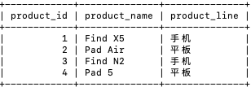
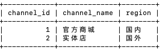
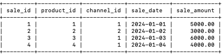
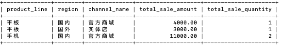

# 分析各产品线在特定时间段内的销售情况

> OPPO 笔试真题 · 2024 秋招 · 数据分析岗
>
> 判题请到[牛客原题](https://www.nowcoder.com/practice/8a002dd7888b4247b6ac9228577bdbc3)提交；本站暂只收录题面与样例。

## 题目描述

【背景】：OPPO 公司为了评估不同产品线在不同销售渠道的销售表现，需要根据以下三个数据表，分析各产品线在特定时间段内的销售情况。

【原始表】：

oppo_products（OPPO 产品）表:

- product_id (产品 ID): 产品的唯一标识符
- product_name (产品名称): 产品的名称
- product_line (产品线): 固定的（手机、平板、耳机）

sales_channels（销售渠道）表:

- channel_id (渠道 ID): 销售渠道的唯一标识符
- channel_name (渠道名称): 销售渠道的名称
- region (地区): 销售渠道所在的地区

sales_data（销售数据）表:

- sale_id (销售 ID): 销售的唯一标识符
- product_id (产品 ID): 所属产品的唯一标识符，用于关联 OPPO 产品表中的产品
- channel_id (渠道 ID): 所属销售渠道的唯一标识符，用于关联销售渠道表中的渠道
- sale_date (销售日期): 销售发生的日期
- sale_amount (销售金额): 本次销售的金额

【要求】：根据上述表格，查询每个产品线在不同地区、不同销售渠道的总销售金额以及销售数量。查询结果按照产品线升序排列，如果产品线一致按照channel_id 升序排列，按照。要求查询出来的表格的字段如下：

- product_line: 产品线。
- region: 地区。
- channel_name: 销售渠道名称。
- total_sale_amount: 总销售金额。
- total_sale_quantity: 销售数量。

【示例】：

oppo_products（OPPO 产品）表:



sales_channels（销售渠道）表:



sales_data（销售数据）表:



【按照要求查询出来的数据】



【解释】

对于平板这个产品线来说，sales_data表中有2笔订单，分别是国内官方商城和国外实体店渠道，每个渠道销售数量是1，分别销售金额是4000和3000。对于手机这个产品线来说，在sales_channels表中有2笔订单但是销售渠道都是国内官方商城，总销售数量是2，销售总金额是5000+6000 = 11000

## 示例

### 示例 1

**输入：**

```sql
DROP TABLE IF EXISTS oppo_products ;
DROP TABLE IF EXISTS sales_channels;
DROP TABLE IF EXISTS sales_data;
-- 创建表
CREATE TABLE oppo_products (
    product_id INT PRIMARY KEY,
    product_name VARCHAR(50),
    product_line VARCHAR(20)
);

CREATE TABLE sales_channels (
    channel_id INT PRIMARY KEY,
    channel_name VARCHAR(50),
    region VARCHAR(20)
);

CREATE TABLE sales_data (
    sale_id INT PRIMARY KEY,
    product_id INT,
    channel_id INT,
    sale_date DATE,
    sale_amount DECIMAL(10, 2)
   
);
-- 插入数据
INSERT INTO oppo_products (product_id, product_name, product_line)
VALUES (1, 'Find X5', '手机'),
       (2, 'Pad Air', '平板'),
       (3, 'Find N2', '手机'),
       (4, 'Pad 5', '平板');

INSERT INTO sales_channels (channel_id, channel_name, region)
VALUES (1, '官方商城', '国内'),
       (2, '实体店', '国外');

INSERT INTO sales_data (sale_id, product_id, channel_id, sale_date, sale_amount)
VALUES (1, 1, 1, '2024-01-01', 5000),
       (2, 2, 2, '2024-01-02', 3000),
       (3, 3, 1, '2024-01-03', 6000),
       (4, 4, 1, '2024-01-04', 4000);
```

**输出：**

```text
product_line|region|channel_name|total_sale_amount|total_sale_quantity
平板|国内|官方商城|4000.00|1
平板|国外|实体店|3000.00|1
手机|国内|官方商城|11000.00|2
```
