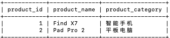
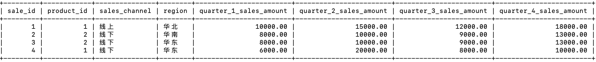
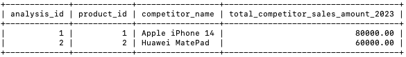
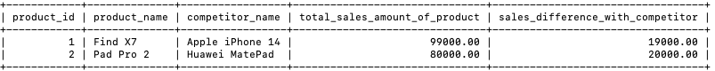

# 深入分析各款产品年总销售额与竞品的年度对比

> OPPO 笔试真题 · 2024 秋招 · 数据开发岗
>
> 判题请到[牛客原题](https://www.nowcoder.com/practice/99cc7f1798a84645a6aca5bdfd163fdb)提交；本站暂只收录题面与样例。

## 题目描述

【背景】：OPPO 公司为了精准评估产品在 2023 年的市场表现，需要根据以下三个数据表，深入分析各款产品年总销售额与竞品的年度对比。

【原始表】：

oppo_products_detail（OPPO 产品详情）表:

- product_id (产品 ID): 产品的唯一标识符
- product_name (产品名称): 产品的名称
- product_category (产品类别): 固定的（智能手机、平板电脑、智能手表）

sales_info（销售信息）表:

- sale_id (销售 ID): 销售的唯一标识符
- product_id (产品 ID): 所属产品的唯一标识符，用于关联 OPPO 产品详情表中的产品
- sales_channel (销售渠道): 固定的（线上、线下）
- region (地区): 产品销售的地区
- quarter_1_sales_amount (第一季度销售额): 产品在该地区、该销售渠道的第一季度销售额
- quarter_2_sales_amount (第二季度销售额): 产品在该地区、该销售渠道的第二季度销售额
- quarter_3_sales_amount (第三季度销售额): 产品在该地区、该销售渠道的第三季度销售额
- quarter_4_sales_amount (第四季度销售额): 产品在该地区、该销售渠道的第四季度销售额

competitor_analysis（竞品）表:

- analysis_id (分析 ID): 竞品的唯一标识符
- product_id (产品 ID): 对应的 OPPO 产品的唯一标识符，用于关联 OPPO 产品详情表中的产品
- competitor_name (竞品名称): 竞品的名称
- total_competitor_sales_amount_2023 (竞品 2023 年全年销售总金额): 竞品 2023 年全年的销售总金额

【要求】：根据上述表格，查询每个产品在不同地区、不同销售渠道下 2023 年的全年销售总额，以及与主要竞品 2023 年全年销售总金额的差值。结果按照产品 ID 升序排列。要求查询出来的表格的字段如下：

- product_id (产品 ID): 对应的 OPPO 产品的唯一标识符，用于关联 OPPO 产品详情表中的产品
- product_name (产品名称): 产品的名称
- competitor_name (竞品名称): 竞品的名称
- total_sales_amount_of_product（产品全年4个季度，全销售渠道的销售总金额）: 产品 2023 年全年的销售总金额
- sales_difference_with_competitor（产品和竞品的销售差值）：2023年产品和竞品的销售差值

【示例】

oppo_products_detail（OPPO 产品详情）表:



sales_info（销售信息）表:



competitor_analysis（竞品）表:



【按照要求查询出来的表】



【解释】

按照上述示例中的数据，产品ID是1的产品全年总销售额 = 10000+15000+12000+18000+6000+20000+8000+10000 = 99000，竞品的销售总金额是80000，差值是19000

## 示例

### 示例 1

**输入：**

```sql
DROP TABLE IF EXISTS oppo_products_detail ;
DROP TABLE IF EXISTS sales_info;
DROP TABLE IF EXISTS competitor_analysis;
-- 创建表
CREATE TABLE oppo_products_detail (
    product_id INT PRIMARY KEY,
    product_name VARCHAR(50),
    product_category VARCHAR(20)
);

CREATE TABLE sales_info (
    sale_id INT PRIMARY KEY,
    product_id INT,
    sales_channel VARCHAR(10),
    region VARCHAR(20),
    quarter_1_sales_amount DECIMAL(10, 2),
    quarter_2_sales_amount DECIMAL(10, 2),
    quarter_3_sales_amount DECIMAL(10, 2),
    quarter_4_sales_amount DECIMAL(10, 2)
);

CREATE TABLE competitor_analysis (
    analysis_id INT PRIMARY KEY,
    product_id INT,
    competitor_name VARCHAR(50),
    total_competitor_sales_amount_2023 DECIMAL(10, 2)
);

-- 插入数据
INSERT INTO oppo_products_detail (product_id, product_name, product_category)
VALUES (1, 'Find X7', '智能手机'),
       (2, 'Pad Pro 2', '平板电脑');

INSERT INTO sales_info (sale_id, product_id, sales_channel, region, quarter_1_sales_amount, quarter_2_sales_amount, quarter_3_sales_amount, quarter_4_sales_amount)
VALUES (1, 1, '线上', '华北', 10000, 15000, 12000, 18000),
       (2, 2, '线下', '华南', 8000, 10000, 9000, 13000),
       (3, 2, '线下', '华东', 8000, 10000, 9000, 13000),
       (4, 1, '线下', '华东', 6000, 20000, 8000, 10000);

INSERT INTO competitor_analysis (analysis_id, product_id, competitor_name, total_competitor_sales_amount_2023)
VALUES (1, 1, 'Apple iPhone 14', 80000),
       (2, 2, 'Huawei MatePad', 60000);
select * from oppo_products_detail;
select * from sales_info;
select * from competitor_analysis;
```

**输出：**

```text
product_id|product_name|competitor_name|total_sales_amount_of_product|sales_difference_with_competitor
1|Find X7|Apple iPhone 14|99000.00|19000.00
2|Pad Pro 2|Huawei MatePad|80000.00|20000.00
```
