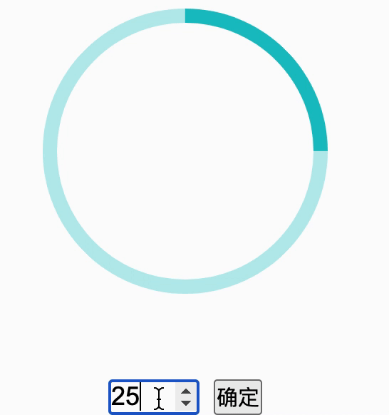

# 环形进度条

> OPPO 笔试真题 · 2023 秋招 · 前端岗
>
> 判题请到[牛客原题](https://www.nowcoder.com/practice/e232caa0be284848b20b46fbbd696434)提交；本站暂只收录题面与样例。

## 题目描述

环形进度条

id为"magnifier"的"section"节点是一个环形进度条模块，而"magnifier"对象用于初始化该模块。该模块的功能如下：

1. 输入框中可以输入数字类型，数值即百分比值；

2. 当点击确定按钮时，环形进度条按输入框中的数值进行渲染；

3. 若输入框中的数据比 0 小，则将输入框中的值置为 0，百分比按 0% 渲染；

4. 若输入框中的数据比 100 大，则将输入框中的值置为 100，百分比按 100% 渲染；

注意：若用户输入数据为小数，则按四舍五入取整处理

请阅读给定的JavaScript代码，并在TODO处完善代码。效果如下：

## 示例
