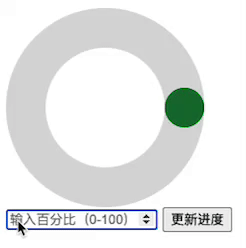

# 进度环

> OPPO 笔试真题 · 2024 秋招 · 前端岗
>
> 判题请到[牛客原题](https://www.nowcoder.com/practice/cc5d58af7e6d4423a97ab29dd7487179)提交；本站暂只收录题面与样例。

## 题目描述

实现一个进度环，当页面输入框中输入对应百分比，进度环动画展示当前百分比。效果如下图：

1. 在输入框中输入0-100的数据，点击更新进度按钮，圆环动画展示当前所占比例。

2. 当在输入框中输入数据超出0-100范围，不再继续往下运行函数，返回null

## 示例
