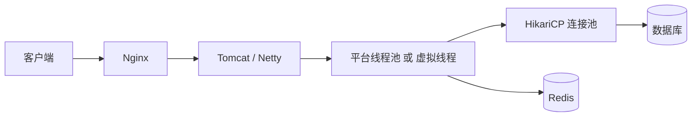

# Java 与操作系统

> JVM 是一个跑在操作系统上的进程：它向 OS 要线程、内存、文件描述符和信号，再把这些能力包装成 Java API。理解这一层，才能解释虚拟线程为什么轻、NIO 为什么能一个线程管很多连接、`-Xmx` 和容器内存为什么会对不上。

## 1. 一张总表

| 操作系统概念 | Java / JVM 接口 | 应用开发中的表现 |
|---|---|---|
| 进程 | `ProcessBuilder`、`ProcessHandle`、`Runtime.exec` | 调用外部命令、子进程管理 |
| 线程 | `Thread`、`ExecutorService`、`ForkJoinPool` | Tomcat 线程池、并行任务 |
| 用户态线程 | 虚拟线程（Java 21+） | 高并发 I/O、每请求一线程 |
| 虚拟内存 / 堆 / 栈 | `-Xmx`、`-Xss`、Metaspace、Direct Memory | OOM、容器内存限制 |
| 文件描述符 | `FileDescriptor`、`SocketChannel`、`FileChannel` | `Too many open files` |
| I/O 多路复用 | `Selector`、`epoll`、NIO | Netty、Tomcat NIO、高并发网关 |
| 信号 | `Runtime.addShutdownHook`、`ProcessHandle` | 优雅停机、`SIGTERM` |
| 进程间通信 | 管道、Unix domain socket、`MappedByteBuffer` | 本机 RPC、共享缓存 |
| CPU 调度 | 平台线程、`ForkJoinPool`、`-XX:ActiveProcessorCount` | 容器 CPU 配额、并行度 |

## 2. 进程：JVM 只是 OS 的一个进程

一个 Java 程序启动后，就是一个操作系统进程；`java` 进程里跑着：

- JVM 运行时（堆、Metaspace、代码缓存、GC、JIT 线程）；
- 主线程；
- GC 线程、JIT 编译线程、Reference Handler、Finalizer 等后台线程；
- 你的业务线程（平台线程或虚拟线程的载体）。

### 2.1 启动子进程

```java
ProcessBuilder pb = new ProcessBuilder("ls", "-l");
pb.redirectErrorStream(true);

Process p = pb.start();
int code = p.waitFor();
System.out.println("exit=" + code);
```

- `ProcessBuilder` 默认**不经过 shell**，参数是列表，天然避免了一部分命令注入；需要管道/通配符时才用 `sh -c`，并严格校验输入。
- `Runtime.exec(String)` 会把字符串按空白拆分，语义不如 `ProcessBuilder` 清晰。
- Java 9+ 的 `ProcessHandle` 可以拿 PID、父进程、启动时间，并注册退出回调：

```java
ProcessHandle.current().info().command().ifPresent(System.out::println);
p.toHandle().onExit().thenAccept(h -> System.out.println("exit " + h.pid()));
```

## 3. 平台线程：一对一映射到 OS 线程

`new Thread(...).start()` 创建的是**平台线程**，在 HotSpot 里一对一映射到操作系统线程（Linux pthread）。线程的创建、调度、上下文切换都由 OS 负责。

```java
Thread t = new Thread(() -> {
    System.out.println(Thread.currentThread());
});
t.start();
t.join();
```

平台线程的成本：

- 默认栈大小约 1 MB（`-Xss` 可调），创建几千个就可能吃光内存；
- 上下文切换由内核完成，数量多了调度开销明显；
- 线程池通过复用线程摊薄创建成本，但池子大小仍然受限于「同时阻塞的线程数」。

### 3.1 线程池

```java
ExecutorService pool = Executors.newFixedThreadPool(8);
Future<Integer> f = pool.submit(() -> 1 + 2);
System.out.println(f.get());
pool.shutdown();
```

`ThreadPoolExecutor` 的核心参数：

| 参数 | 含义 | 常见坑 |
|---|---|---|
| `corePoolSize` | 常驻线程数 | 太小撑不住并发，太大浪费内存 |
| `maximumPoolSize` | 最大线程数 | 无界队列时永远用不到 |
| `keepAliveTime` | 空闲线程存活时间 | 短任务频繁创建/销毁 |
| `workQueue` | 任务队列 | `LinkedBlockingQueue` 无界 → 堆积/OOM |
| `handler` | 拒绝策略 | 默认 `AbortPolicy` 直接抛异常 |

Tomcat 的 `maxThreads` 就是平台线程上限；同步阻塞的请求会一直占着线程，所以「一个请求一个线程」在高并发下很快遇到瓶颈。

## 4. 虚拟线程：JVM 调度的用户态线程

Java 21 正式引入虚拟线程（JEP 444）。它不是 OS 线程，而是由 JVM 调度到少量**载体线程**（carrier threads，通常是 `ForkJoinPool` 的工作线程）上执行：

```text
虚拟线程 1 ─┐
虚拟线程 2 ─┼──► 载体线程（平台线程，目标数量 ≈ CPU 核数）
虚拟线程 3 ─┘
```

- 虚拟线程阻塞在**网络/NIO、`Thread.sleep`、`java.util.concurrent` 阻塞**上时，会从载体线程**卸载**（unmount），载体线程去跑别的虚拟线程；
- **文件 I/O、`Object.wait()`** 等阻塞不一定会卸载，会占住载体线程；调度器会临时扩大并行度（上限 `jdk.virtualThreadScheduler.maxPoolSize`，默认 256），所以「载体线程数 ≈ 核数」是目标值，不是硬上限；
- 创建成本很低，可以「一个请求一个虚拟线程」，不需要池化；
- 默认是守护线程，不能设置优先级；
- `Thread.isVirtual()` 可判断。

```java
try (ExecutorService executor = Executors.newVirtualThreadPerTaskExecutor()) {
    for (int i = 0; i < 10_000; i++) {
        executor.submit(() -> {
            Thread.sleep(1000);      // 阻塞时自动卸载
            return null;
        });
    }
}   // close() 等待所有任务结束
```

### 4.1 什么时候会「钉住」载体线程

在 Java 21/22/23 中，虚拟线程在 `synchronized` 块里阻塞时可能**钉住**（pin）载体线程，导致其他虚拟线程无法调度：

```java
synchronized (lock) {
    Thread.sleep(1000);   // 21~23：可能 pin 住载体线程
}
```

- 替代方案：用 `ReentrantLock` 代替 `synchronized`；
- Java 24+（JEP 491）已经消除了 `synchronized` 导致的 pinning，但 native 方法/外部函数调用仍可能钉住；
- 排查：`-Djdk.tracePinnedThreads=full` 在 21–23 会打印钉住栈；24+ 只剩 native/FFM 场景，属性可能没有输出。

### 4.2 不要池化虚拟线程

虚拟线程很便宜，池化反而掩盖了「任务阻塞」的问题。正确姿势是每个任务一个虚拟线程，用 `ExecutorService` 或 `StructuredTaskScope`（21 预览，25 转正）管理生命周期。

### 4.3 `ThreadLocal` 与 `ScopedValue`

每个虚拟线程都有自己的 `ThreadLocal`，但「一百万个虚拟线程各存一份」会非常占内存。Java 21 引入 `ScopedValue`（预览，25 转正）作为更轻的上下文传递方式；在旧版本里，至少要在任务结束时 `remove()`，避免线程池复用导致泄漏。

```java
ThreadLocal<User> current = new ThreadLocal<>();
try {
    current.set(user);
    // ...
} finally {
    current.remove();     // 线程池里必须清理
}
```

## 5. 内存：JVM 的运行时数据区

```text
JVM 进程
├─ Heap（-Xmx/-Xms）          对象实例
├─ Metaspace                  类元数据、常量池、方法字节码
├─ Code Cache                 JIT 编译后的机器码
├─ Thread Stack（-Xss）       每个平台线程的栈帧
├─ Direct Memory              DirectByteBuffer、Netty ByteBuf
├─ GC / JIT / 内部结构
└─ Native Memory              JNI、malloc、线程栈、文件映射
```

关键参数：

| 参数 | 作用 | 备注 |
|---|---|---|
| `-Xms` / `-Xmx` | 堆初始/最大 | 生产常设成相同值，减少扩容抖动 |
| `-Xss` | 每个平台线程栈大小 | 递归深/线程多时要权衡 |
| `-XX:MaxMetaspaceSize` | 元空间上限 | 默认无上限，类加载泄漏会吃光内存 |
| `-XX:MaxDirectMemorySize` | 堆外直接内存上限 | 默认约等于 `-Xmx` |
| `-XX:MaxRAMPercentage` | 容器内堆占可用内存比例 | 比写死 `-Xmx` 更适合容器 |
| `-XX:ActiveProcessorCount` | 覆盖 JVM 看到的 CPU 数 | 容器 CPU 配额不准确时用 |

容器里常见两个误区：

- **`-Xmx` 设成容器内存的 90%**：堆之外还有 Metaspace、Code Cache、线程栈、Direct Memory，容易被 OOMKilled；
- **`Runtime.availableProcessors()` 看到宿主机核数**：JDK 10 之前（8 为 8u191 之前）不感知 cgroup，线程池/并行流会开得过大；现代 JDK 默认 `-XX:+UseContainerSupport`，仍可用 `-XX:ActiveProcessorCount` 显式覆盖。

## 6. NIO：文件描述符与 I/O 多路复用

### 6.1 `FileChannel` 与 `ByteBuffer`

`FileChannel` 是文件/通道的 NIO 抽象；`ByteBuffer` 的 `position`/`limit`/`capacity`、`flip`/`clear`/`compact`，以及 `Selector` 的完整 echo 示例，统一放在 [Java 与计算机网络](./计算机网络.md) §4。这里只强调两件事：

- 文件、socket、管道都占 fd，`Channel` 关闭要用 `try-with-resources`；
- 文件 I/O 在虚拟线程里不一定会卸载，别把「虚拟线程 = 所有阻塞都免费」当成前提。

### 6.2 直接内存与 `MappedByteBuffer`

- `ByteBuffer.allocate(n)`：堆内数组，受 GC 管理；
- `ByteBuffer.allocateDirect(n)`：堆外内存，不受 `-Xmx` 限制，受 `-XX:MaxDirectMemorySize` 限制；
- `FileChannel.map(...)`：把文件映射到虚拟内存，返回 `MappedByteBuffer`，适合大文件随机读写。

```java
try (FileChannel ch = FileChannel.open(Path.of("big.bin"), StandardOpenOption.READ)) {
    MappedByteBuffer mm = ch.map(FileChannel.MapMode.READ_ONLY, 0, ch.size());
    System.out.println(mm.getInt(0));
}
```

直接内存的回收依赖 `Cleaner`：对象被 GC 后才释放；如果 DirectByteBuffer 很多而堆很空闲，可能迟迟不触发 GC，表现为「堆没满，进程却被 OOMKilled」。可以显式调用 `System.gc()`（不推荐）或使用 `-XX:MaxDirectMemorySize` 限制，并用 Netty 的引用计数/内存池管理。

### 6.3 `Selector`：OS 层的 fd 复用

`Selector` 是 Java 对 `epoll`/`kqueue` 的封装：一个线程注册多个 `Channel`，`select()` 返回就绪事件。完整示例见网络篇 §4；这里只记住：

- 每个注册的 `Channel` 占一个 fd，`Selector` 本身也占一个 fd；
- Linux 下底层是 `epoll`，macOS 是 `kqueue`；
- `epoll` 空轮询（selector 一直返回但无事件）是经典坑，Netty 用 `selectNow` 计数规避。

### 6.4 文件描述符

每个打开的 socket、文件、管道都占一个 fd。查看和限制：

```bash
ulimit -n                 # 当前进程的 fd 上限
lsof -p <pid> | wc -l     # 进程打开了多少 fd
ls /proc/<pid>/fd | wc -l
```

常见泄漏：`Socket`/`FileChannel`/`Connection` 没有关闭；`try-with-resources` 能覆盖大多数场景。

## 7. 信号与优雅停机

JVM 收到 `SIGTERM` 时会执行已注册的 shutdown hook，然后退出：

```java
Runtime.getRuntime().addShutdownHook(new Thread(() -> {
    System.out.println("shutting down...");
    // 停止接收新请求、关闭连接池、flush 日志
}));
```

注意：

- hook 里不要做长时间阻塞，OS 等一段时间后会 `SIGKILL`；
- Spring Boot 提供 `server.shutdown=graceful`，会先停止接收新请求，再等待在途请求；
- `SIGINT`（Ctrl+C）默认也会触发 shutdown hook；
- `kill -3 <pid>`（`SIGQUIT`）会让 HotSpot 打印线程转储到标准输出，等价于一次 `jstack`，是线上排障的常用信号；
- `sun.misc.Signal` 是内部 API，生产代码尽量用框架提供的生命周期钩子。

## 8. 进程间通信

| 方式 | Java API | 特点 |
|---|---|---|
| 管道 | `ProcessBuilder` 的 stdin/stdout | 父子进程，字节流 |
| Unix domain socket | `UnixDomainSocketAddress`（Java 16+） | 本机高性能，避免 TCP 栈 |
| 共享内存 / 文件映射 | `FileChannel.map`、`MappedByteBuffer` | 零拷贝，需自己同步 |
| TCP/UDP | `SocketChannel`、`DatagramChannel` | 跨机，通用 |
| 信号 | `ProcessHandle.destroy` | 只能发有限信号，跨平台差异大 |

## 9. 一个 Spring Boot 服务的 OS 视角



- Tomcat 默认用平台线程池处理请求；开启虚拟线程后，每个请求一个虚拟线程，阻塞 I/O 时卸载；
- HikariCP 的连接是有限资源，虚拟线程再多也不能让数据库连接变多；
- 容器里要同时看堆、Metaspace、Direct Memory、线程栈和 fd；
- 优雅停机要等 Tomcat 停止接收、线程池排空、连接池关闭。

## 10. 常见坑

- **`Thread.stop()`**：强制终止线程，可能留下不一致状态；用中断/标志位。
- **虚拟线程 + `synchronized`**：21~23 可能 pin 住载体线程；改用 `ReentrantLock`。
- **`ThreadLocal` 不清理**：线程池复用线程，下一次请求读到上一次的数据。
- **DirectByteBuffer 泄漏**：堆没满但堆外内存涨，最终 OOM。
- **`-Xmx` 等于容器内存**：Metaspace/栈/直接内存没有余量，被 OOMKilled。
- **fd 泄漏**：连接/文件没有关闭，最终 `Too many open files`。
- **`System.gc()` 当调优手段**：触发 Full GC，停顿不可控。

## 11. 动手实验

```bash
# 1. 看线程
jcmd <pid> Thread.print
jstack <pid> | grep -c 'java.lang.Thread.State'

# 2. 看堆与 GC
jcmd <pid> GC.heap_info
jmap -histo <pid> | head
jstat -gc <pid> 1000 5

# 3. 看原生内存（需要 -XX:NativeMemoryTracking=summary）
jcmd <pid> VM.native_memory summary

# 4. 看 fd
ls /proc/<pid>/fd | wc -l
```

```java
// 虚拟线程：同样睡 1 秒，观察创建数量与耗时
import java.time.Duration;
import java.util.concurrent.Executors;

public class ThreadLab {
    public static void main(String[] args) {
        long t0 = System.nanoTime();
        try (var ex = Executors.newVirtualThreadPerTaskExecutor()) {
            for (int i = 0; i < 10_000; i++) {
                ex.submit(() -> {
                    Thread.sleep(Duration.ofSeconds(1));
                    return null;
                });
            }
        }
        System.out.printf("virtual: %.2f s%n", (System.nanoTime() - t0) / 1e9);
    }
}
```

## 12. 小结

- 平台线程一对一映射 OS 线程；虚拟线程由 JVM 调度，网络/NIO 等阻塞时卸载，适合高并发 I/O；文件 I/O 等不一定卸载。
- 虚拟线程不要池化；注意 `synchronized` 在旧版本的 pinning，以及 `ThreadLocal` 的内存成本。
- JVM 内存不止堆：还有 Metaspace、Code Cache、线程栈、Direct Memory；容器里要留余量。
- NIO 的核心是 `ByteBuffer` + `Channel` + `Selector`；Linux 下 `Selector` 底层是 `epoll`。
- fd、信号、IPC 都是 OS 资源；框架封装得再好，泄漏了也会以 `Too many open files` 或 OOMKilled 的形式出现。
