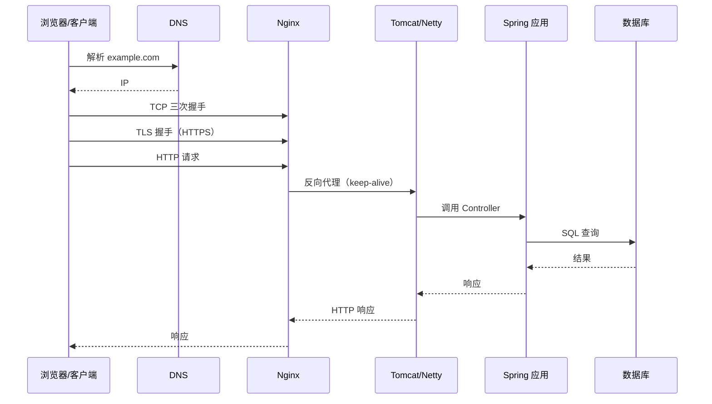

# Java 与计算机网络

> Java 的网络 API 分三层：`Socket`/`ServerSocket` 是对 OS socket 的封装，NIO 的 `Channel`/`Selector` 是对 I/O 多路复用的封装，`HttpClient`/Netty 则是在它们之上做协议解析。把这三层对上，排障才不会只靠猜。

## 1. 一张总表

| 网络层次 | 代表协议 | Java 载体 | 应用开发中的表现 |
|---|---|---|---|
| 应用层 | HTTP/HTTPS、WebSocket、DNS | `HttpClient`、`HttpURLConnection`、`WebSocket`、`InetAddress` | API 调用、网关、推送 |
| 传输层 | TCP、UDP | `Socket`/`ServerSocket`、`DatagramSocket`、`SocketChannel` | 连接、可靠传输、粘包 |
| 网络层 | IP、ICMP | `InetAddress`、`NetworkInterface` | 地址解析、网卡信息 |
| 链路层 | Ethernet、Wi-Fi | 由 OS 负责 | 一般不需要 Java 介入 |

`HttpClient` 不是「网络本身」：DNS、TCP、TLS 都由 JDK 和操作系统完成，它负责拼 HTTP 报文、解析响应、管理连接池。

## 2. TCP Socket：可靠字节流

### 2.1 服务端与客户端

```java
// server
try (ServerSocket server = new ServerSocket()) {
    server.setReuseAddress(true);
    server.bind(new InetSocketAddress("127.0.0.1", 9000), 128);
    System.out.println("listening on 9000");

    try (Socket conn = server.accept()) {
        InputStream in = conn.getInputStream();
        OutputStream out = conn.getOutputStream();
        byte[] buf = new byte[4096];
        int n;
        while ((n = in.read(buf)) != -1) {
            out.write(buf, 0, n);      // echo
            out.flush();
        }
    }
}
```

```java
// client
try (Socket s = new Socket()) {
    s.connect(new InetSocketAddress("127.0.0.1", 9000), 3000);
    s.setSoTimeout(3000);
    s.getOutputStream().write("hello".getBytes(StandardCharsets.UTF_8));
    System.out.println(new String(s.getInputStream().readNBytes(5), StandardCharsets.UTF_8));
}
```

### 2.2 `read` 不保证一次读完

TCP 是**字节流**，没有消息边界。`InputStream.read(buf)` 返回实际读到的字节数，可能小于 `buf.length`；对端两次 `write`，这边可能一次 `read` 就全收到。应用层必须自己定边界。

最常见的两种做法：

```java
// 1) 长度前缀：先读 4 字节长度，再读 body
DataOutputStream out = new DataOutputStream(socket.getOutputStream());
out.writeInt(payload.length);
out.write(payload);
out.flush();

DataInputStream in = new DataInputStream(socket.getInputStream());
int length = in.readInt();
byte[] body = in.readNBytes(length);   // 一定读满 length
```

```java
// 2) 换行分隔：适合 JSON Lines / 日志流
BufferedReader reader = new BufferedReader(
    new InputStreamReader(socket.getInputStream(), StandardCharsets.UTF_8));
String line = reader.readLine();       // 不含换行符
```

`readNBytes(n)` 在 Java 9+ 可用，会循环读到 n 字节或 EOF；`readFully(byte[])` 是 `DataInputStream` 的等价方法。

### 2.3 常用选项

| 方法 | 作用 |
|---|---|
| `setSoTimeout(ms)` | 读超时；0 表示无限等待 |
| `setTcpNoDelay(true)` | 关闭 Nagle，降低小包延迟 |
| `setKeepAlive(true)` | 开启 TCP keepalive（默认间隔很长） |
| `setReuseAddress(true)` | 复用 `TIME_WAIT` 端口 |
| `shutdownOutput()` | 只关闭写方向，仍可读响应 |
| `close()` | 关闭 socket，同时关闭流 |

`ServerSocket.bind(addr, backlog)` 的 backlog 是等待 `accept` 的队列长度；突发连接多时要调大。

## 3. UDP：数据报

```java
try (DatagramSocket socket = new DatagramSocket(9001)) {
    byte[] buf = new byte[65535];
    DatagramPacket packet = new DatagramPacket(buf, buf.length);
    socket.receive(packet);
    System.out.println(new String(packet.getData(), 0, packet.getLength()));
}
```

UDP 保留消息边界，但不保证送达、顺序和去重。DNS 主要走 UDP 53（响应大时回退 TCP），实时音视频、指标上报也常用 UDP。需要可靠性就在应用层做序号/重传，或使用 QUIC。

## 4. NIO：一个线程管多个连接

### 4.1 `ByteBuffer` 的状态

`ByteBuffer` 有三个指针：`position`（下一个读写位置）、`limit`（边界）、`capacity`（容量）。

```java
ByteBuffer buf = ByteBuffer.allocate(1024);
buf.put("hello".getBytes());   // 写模式，position 前移
buf.flip();                    // limit = position, position = 0
while (buf.hasRemaining()) {
    System.out.print((char) buf.get());
}
buf.clear();                   // 回到写模式
```

堆内 `allocate` 受 GC 管理；`allocateDirect` 是堆外内存，受 `-XX:MaxDirectMemorySize` 限制；`FileChannel.map` 返回 `MappedByteBuffer`，适合大文件。

### 4.2 `Selector` 事件循环

```java
try (ServerSocketChannel server = ServerSocketChannel.open()) {
    server.bind(new InetSocketAddress(9000));
    server.configureBlocking(false);

    Selector selector = Selector.open();
    server.register(selector, SelectionKey.OP_ACCEPT);

    while (true) {
        selector.select();
        Iterator<SelectionKey> it = selector.selectedKeys().iterator();
        while (it.hasNext()) {
            SelectionKey key = it.next();
            it.remove();

            if (key.isAcceptable()) {
                SocketChannel client = server.accept();
                client.configureBlocking(false);
                client.register(selector, SelectionKey.OP_READ);
            } else if (key.isReadable()) {
                SocketChannel client = (SocketChannel) key.channel();
                ByteBuffer buf = ByteBuffer.allocate(1024);
                int n = client.read(buf);
                if (n == -1) {
                    client.close();
                } else if (n > 0) {
                    buf.flip();
                    client.write(buf);
                }
            }
        }
    }
}
```

Linux 下 `Selector` 底层是 `epoll`；macOS 是 `kqueue`。Netty、Tomcat NIO、Undertow 都是在这个模型上做封装。

## 5. HTTP：`HttpClient` 与 `HttpURLConnection`

### 5.1 Java 11+ 的 `HttpClient`

```java
HttpClient client = HttpClient.newBuilder()
    .connectTimeout(Duration.ofSeconds(3))
    .version(HttpClient.Version.HTTP_2)
    .followRedirects(HttpClient.Redirect.NORMAL)
    .build();

HttpRequest request = HttpRequest.newBuilder()
    .uri(URI.create("https://example.com/api"))
    .timeout(Duration.ofSeconds(10))
    .header("Accept", "application/json")
    .GET()
    .build();

HttpResponse<String> response = client.send(
    request, HttpResponse.BodyHandlers.ofString(StandardCharsets.UTF_8));

System.out.println(response.statusCode());
System.out.println(response.body());
```

- `HttpClient` 不可变、线程安全，内部维护连接池；Java 21+ 可以 `close()`。
- `send` 阻塞，`sendAsync` 返回 `CompletableFuture<HttpResponse<T>>`。
- 默认不跟随重定向，要显式设置 `followRedirects`。
- 请求超时用 `HttpRequest.timeout`；连接超时用 `HttpClient.connectTimeout`；两者都不设时可能无限等待。
- `BodyHandlers.ofString`、`ofByteArray`、`ofFile`、`discarding`；上传用 `BodyPublishers.ofString/ofFile/noBody`。

### 5.2 `HttpURLConnection`

老 API，仍然存在于很多遗留代码里：

```java
HttpURLConnection conn = (HttpURLConnection) new URL("https://example.com").openConnection();
conn.setConnectTimeout(3000);
conn.setReadTimeout(10000);
conn.setRequestMethod("GET");

try (InputStream in = conn.getInputStream()) {
    // 读取
} finally {
    conn.disconnect();
}
```

注意：`setConnectTimeout`/`setReadTimeout` 默认是 **0（无限）**；`getInputStream` 在 4xx/5xx 时抛异常，错误响应要走 `getErrorStream()`。

### 5.3 TLS

```java
SSLContext ctx = SSLContext.getInstance("TLS");
ctx.init(null, null, null);          // 使用默认 truststore
SSLSocketFactory factory = ctx.getSocketFactory();

try (SSLSocket socket = (SSLSocket) factory.createSocket("example.com", 443)) {
    socket.startHandshake();
    // 读写
}
```

- 默认 truststore 是 `$JAVA_HOME/lib/security/cacerts`，也可以用 `-Djavax.net.ssl.trustStore=...` 指定。
- 客户端证书（mTLS）需要加载 keystore，并配置 `KeyManagerFactory`。
- 主机名校验默认开启；自定义 `HostnameVerifier` 返回 `true` 等于关闭校验，生产环境不要这么做。
- 自签名证书调试时，把证书导入 truststore，而不是全局关闭验证。

## 6. Netty：事件驱动 + 零拷贝

Netty 不是 JDK 的一部分，但它是 Java 高并发网络的事实标准：

```text
EventLoopGroup（Reactor 线程）
  └─ Channel（连接）
      └─ ChannelPipeline
          ├─ LengthFieldBasedFrameDecoder   // 解决粘包
          ├─ StringDecoder / StringEncoder
          └─ 业务 Handler
```

核心概念：

- `EventLoop`：一个线程绑定多个 `Channel`，所有 I/O 事件在该线程串行处理；
- `ByteBuf`：可读/可写双指针，支持池化和堆外内存；
- `LengthFieldBasedFrameDecoder`：按长度字段拆帧，避免手写粘包逻辑；
- 零拷贝：`FileRegion`、`CompositeByteBuf`、堆外 direct buffer。

用 Netty 的场景：自定义协议、网关、IM、RPC。普通 HTTP 客户端/服务端优先用 JDK `HttpClient` 或 Spring 生态，不要为了「高性能」上 Netty。

## 7. DNS 与地址解析

```java
InetAddress[] addresses = InetAddress.getAllByName("example.com");
for (InetAddress a : addresses) {
    System.out.println(a.getHostAddress());
}
```

- `InetAddress` 会缓存解析结果，缓存时间受 `networkaddress.cache.ttl` 等安全属性影响。
- `/etc/hosts` 优先于 DNS；容器里经常通过它做本机映射。
- IPv6 优先但网络不通时，可能出现「解析成功、连接超时」；可以显式用 `InetAddress.getByName` 拿 IPv4 排查。
- 需要查 MX/TXT/CNAME 等记录时，用 JNDI DNS provider 或专门的 DNS 客户端；`InetAddress` 只做地址解析。

## 8. 排障：从现象到命令

| 现象 | 可能原因 | 先看什么 |
|---|---|---|
| `ConnectException: Connection refused` | 端口没监听、防火墙 reject | `ss -tulpn`、`lsof -i :8080` |
| `SocketTimeoutException` | 防火墙 drop、服务过载、读超时太短 | `curl -v`、`tcpdump`、线程栈 |
| `SocketException: Connection reset` | 对端 RST、代理断开、半开连接 | 服务端日志、`tcpdump` |
| `UnknownHostException` | DNS 解析失败 | `getent hosts`、`nslookup` |
| `SSLHandshakeException` | 证书链、主机名、协议版本 | `openssl s_client -connect` |
| 偶发超时 | 连接池耗尽、TIME_WAIT、backlog 满 | `ss -s`、连接池指标、`jstack` |

常用命令：

```bash
ss -tulpn                 # 监听端口与进程
ss -s                     # 套接字统计
lsof -i :8080             # 谁占了 8080
curl -v https://example.com
tcpdump -i any -n port 8080
nc -vz example.com 443
```

JVM 侧：

```bash
jcmd <pid> Thread.print                  # 看阻塞在哪个 socket read
jcmd <pid> GC.heap_info
jstack <pid> | grep -A 20 'SocketInputStream'
```

## 9. 一个请求的旅程



链路上的瓶颈：

- DNS 慢：首字节时间变长；
- TCP/TLS 握手慢：高延迟、证书链长；
- Tomcat `maxThreads` 不足：请求排队；
- 同步阻塞调用占满线程池；
- HikariCP 连接池耗尽：请求等连接；
- Netty `EventLoop` 里做阻塞操作：整个线程的连接都卡住。

### WebSocket 与 SSE

- **WebSocket**：HTTP Upgrade 后全双工，JDK 11+ 提供 `HttpClient.newWebSocketBuilder()` 和 `WebSocket.Listener`。
- **SSE**：服务端单向推送 `text/event-stream`；JDK `HttpClient` 没有专门的 SSE API，可以用 `BodyHandlers.ofLines()` 逐行读取并解析。

## 10. 常见坑

- **不设超时**：`HttpURLConnection` 默认无限等待；`HttpClient` 也需要显式设置。
- **以为 `read` 一次就是一条消息**：TCP 是字节流，必须自己定帧。
- **`Socket`/`Channel` 没关闭**：fd 泄漏，最终 `Too many open files`。
- **在 Netty `EventLoop` 里做阻塞调用**：一个连接卡住，整个线程上的连接都停。
- **`HttpClient` 默认不跟随重定向**：301/302 需要自己处理。
- **关闭 TLS 校验**：`HostnameVerifier` 返回 true 或信任所有证书，等于打开中间人攻击。
- **DNS 缓存**：改了解析记录，JVM 可能还拿着旧地址。
- **代理环境变量**：`http.proxyHost`/`https.proxyHost` 或 `ProxySelector` 配置不当，内网请求被代理走。

## 11. 动手实验

```bash
# 1. 起一个本地 TCP echo 服务（用上面的 ServerSocket 代码）
# 2. 测连通性
nc -vz 127.0.0.1 9000
printf 'hello\n' | nc 127.0.0.1 9000

# 3. 看端口与连接
ss -tulpn | grep 9000
ss -tan state time-wait | wc -l

# 4. 抓包
tcpdump -i lo -n port 9000 -c 20
```

```java
// 用 HttpClient 测一次请求的耗时
HttpClient client = HttpClient.newBuilder()
    .connectTimeout(Duration.ofSeconds(3))
    .build();

HttpRequest req = HttpRequest.newBuilder()
    .uri(URI.create("https://example.com"))
    .timeout(Duration.ofSeconds(10))
    .GET()
    .build();

long t0 = System.nanoTime();
HttpResponse<String> resp = client.send(req, HttpResponse.BodyHandlers.ofString());
System.out.printf("status=%d, %.2f ms%n",
    resp.statusCode(), (System.nanoTime() - t0) / 1e6);
```

## 12. 小结

- `Socket` 是 OS socket 的封装；TCP 是字节流，应用层必须自己定帧。
- NIO 用 `Channel` + `ByteBuffer` + `Selector` 实现一个线程管多个连接；Linux 下底层是 `epoll`。
- `HttpClient` 是 Java 11+ 的现代 HTTP 客户端；`HttpURLConnection` 是遗留 API，默认无超时。
- TLS 的核心是 truststore/keystore 与主机名校验；不要用「信任所有证书」换方便。
- Netty 适合自定义协议和高并发网关；普通 HTTP 场景优先用 JDK/Spring 生态。
- 排障先分层：DNS → TCP → TLS → HTTP → 应用，再用 `ss`、`curl -v`、`tcpdump`、`jstack` 逐层验证。
