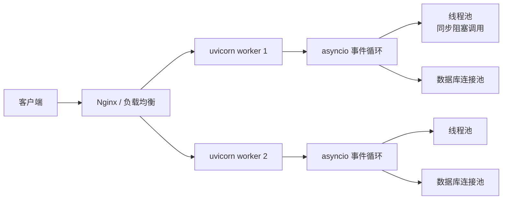

# Python 与操作系统

> Python 程序不是跑在真空里：它向操作系统要地址空间、线程、文件描述符和信号。理解这些，才能解释 GIL 为什么存在、`async` 为什么不阻塞、`multiprocessing` 为什么能绕开 GIL、文件描述符为什么会泄漏。

## 1. 一张总表

| 操作系统概念 | Python 接口 | 应用开发中的表现 |
|---|---|---|
| 进程 | `os.fork`、`multiprocessing`、`subprocess` | Web 服务的多 worker、CPU 密集任务隔离 |
| 线程 | `threading`、`concurrent.futures.ThreadPoolExecutor` | I/O 并发、GIL 竞争 |
| 协程 | `asyncio` | 高并发网络服务、WebSocket/SSE |
| 虚拟内存 / 堆 / 栈 | `mmap`、`resource`、`tracemalloc` | 内存占用、OOM、缓存 |
| 文件描述符 | `os.open`、`socket.fileno`、`selectors` | 连接泄漏、`Too many open files` |
| I/O 多路复用 | `select`/`poll`/`epoll`、`selectors`、`asyncio` | C10K、反向代理、数据库连接池 |
| 信号 | `signal` | 优雅停机、`SIGTERM`、`Ctrl+C` |
| 进程间通信 | `multiprocessing.Queue/Pipe/SharedMemory` | worker 池、任务分发、共享缓存 |
| 调度与时间 | `time`、`sched`、`asyncio` 事件循环 | 超时、重试、定时任务 |

## 2. 进程：隔离与并行

### 2.1 `fork` 与写时复制

在 Unix 上，`os.fork()` 创建一个子进程：父进程返回子进程 PID，子进程返回 `0`。

```python
import os

pid = os.fork()
if pid == 0:
    print("child", os.getpid())
    os._exit(0)
else:
    print("parent", os.getpid(), "child", pid)
    os.waitpid(pid, 0)
```

`fork` 之后父子进程拥有各自独立的地址空间，但采用**写时复制**：刚 fork 完并不复制物理内存，谁写谁复制。这让「fork 一个进程」比「重新加载整个解释器」便宜。

一个清理义务要记住：子进程退出后，父进程若不调用 `wait`/`waitpid`，子进程的进程表项会一直保留在内核——这就是**僵尸进程**；它的内存已释放，但占一个 PID，大量堆积会耗尽进程表。若父进程先于子进程退出，孤儿进程转由 init 进程收养并负责回收。

### 2.2 `multiprocessing` 的启动方式

| 平台 | 默认 start method | 特点 |
|---|---|---|
| Linux | `fork` | 快，但 fork 后线程状态可能不一致 |
| macOS（3.8+） | `spawn` | 重新启动解释器，安全但慢 |
| Windows | `spawn` | 只支持 `spawn`，必须保护入口 |

```python
import multiprocessing as mp

def work(x):
    return x * x

if __name__ == "__main__":          # spawn 模式必须有这行
    with mp.Pool(4) as pool:
        print(pool.map(work, range(8)))
```

`spawn` 会重新导入主模块，所以入口必须放在 `if __name__ == "__main__":` 下；否则子进程会递归创建进程。

### 2.3 `subprocess`：调用外部程序

```python
import subprocess

# 推荐：参数列表 + 不经过 shell
result = subprocess.run(
    ["ls", "-l"],
    capture_output=True,
    text=True,
    timeout=5,
    check=True,
)
print(result.stdout)
```

`shell=True` 会把字符串交给 shell 解释，用户可控的输入容易变成命令注入。除非确实需要管道、通配符等 shell 特性，否则保持默认的 `shell=False`。

## 3. 线程与 GIL

**线程（thread）**是进程内的独立执行流。同一进程内的所有线程共享进程的地址空间和资源——与进程相比，线程的创建与切换不需要复制或切换地址空间，这是它的成本优势；共享地址空间同时意味着多个线程可以直接读写同一份内存，数据竞争由此而来。

**GIL（全局解释器锁，Global Interpreter Lock）**是 CPython 解释器内部的一把互斥锁：同一时刻，每个进程内最多只有一个线程持有 GIL 并执行 Python 代码。即使机器有多个 CPU 核，传统 CPython 的多线程也只能在解释器层串行执行。

### 3.1 Python 线程就是操作系统线程

`threading.Thread` 最终调用平台的线程 API（Linux 的 pthread、Windows 的线程）。线程的创建、调度、上下文切换都由操作系统负责，与你用 C 写多线程程序使用的是同一套机制；Python 额外叠加的只有 GIL 这一层。

### 3.2 GIL 到底限制了什么

CPython 的传统构建里，同一时刻只有一个线程能执行 Python 字节码（Python 源码先被编译成解释器执行的中间指令——字节码——由虚拟机逐条解释执行，而非直接翻译为机器码）。GIL 保护的是解释器内部状态，主要是每个对象头里的**引用计数**（记录指向该对象的引用个数，归零即触发析构；详见 §5），而不是业务数据。也就是说：GIL 保证解释器内部状态在多线程下自洽，不保证你的共享数据不受竞态影响（3.3 演示了这一点）。

为什么 CPython 需要这样一把全局锁：解释器的内存管理（引用计数、对象分配、GC 触发）本身不是线程安全的；全局锁是「一个锁解决所有互斥」的最简单实现，且对单线程执行零成本。反过来，给每个内部状态配细粒度锁不仅实现复杂，还会带来锁获取开销。free-threaded 构建（见 3.4）就是放弃这个折中后重建细粒度同步的路线。

一个常见的过时说法是「每执行 100 条字节码切换一次」。从 Python 3.2 起，GIL 的切换已经改成**按时间片**：

```python
import sys
print(sys.getswitchinterval())     # 默认 0.005 秒
sys.setswitchinterval(0.001)       # 调小，切换更频繁
```

GIL 的关键行为：

- **CPU 密集型**：多线程基本跑不满多核，因为同一时刻只有一个线程在执行字节码。
- **I/O 密集型**：线程在 `read`、`recv`、`sleep` 等系统调用阻塞时会**释放 GIL**，其他线程可以继续跑，所以多线程仍然有效。
- **C 扩展**：NumPy 等库在执行耗时计算时可能主动释放 GIL，这时多线程能真正并行。

```python
from concurrent.futures import ThreadPoolExecutor, ProcessPoolExecutor

# 片段：fetch_url / urls / heavy_compute / data 省略
# I/O 密集：线程池
with ThreadPoolExecutor(max_workers=8) as ex:
    results = list(ex.map(fetch_url, urls))

# CPU 密集：进程池
with ProcessPoolExecutor(max_workers=4) as ex:
    results = list(ex.map(heavy_compute, data))
```

### 3.3 GIL 不等于线程安全

GIL 只保证「字节码之间」不并行，不保证复合操作原子。`count += 1` 会编译成「读、加、写」多条字节码，线程切换可能发生在中间：

```python
import threading

count = 0
lock = threading.Lock()

def inc_no_lock():
    global count
    for _ in range(100_000):
        count += 1          # 读-加-写，可能丢失更新

def inc_locked():
    global count
    for _ in range(100_000):
        with lock:
            count += 1

def run(fn):
    global count
    count = 0
    threads = [threading.Thread(target=fn) for _ in range(2)]
    for t in threads:
        t.start()
    for t in threads:
        t.join()
    return count

print("no lock:", run(inc_no_lock))   # 通常小于 200000
print("locked :", run(inc_locked))    # 200000
```

需要共享可变状态时，仍然要用 `Lock`、`RLock`、`queue.Queue` 或不可变数据。

### 3.4 自由线程构建

Python 3.13 提供实验性的 **free-threaded build**（PEP 703），3.14 起转为官方支持，可以关闭 GIL。它不是「自动变快」：没有 GIL 之后，引用计数和容器操作需要更细的锁，业务代码里的竞态反而更容易暴露；同时 C 扩展需要重新编译并声明线程安全。生产环境是否采用，要看依赖生态。

## 4. 协程：单线程里的并发

`asyncio` 是**协作式**并发：一个线程跑事件循环，协程在 `await` 处主动让出控制权。它适合「大量连接、每个连接大部分时间在等 I/O」的场景。

先用一句话把三个词说清楚，后面反复用到：

- **协程（coroutine）**：一个**可以执行到一半就暂停、稍后从暂停处继续**的函数。
- **事件循环（event loop）**：单线程里跑着的一个 `while True`，它一遍遍地问「现在该轮到哪个协程跑了？」，然后跑那个协程，直到它再次让出。
- **`await`**：协程里唯一能让出的地方。执行到 `await` 就暂停这个协程，把控制权还给事件循环。

### 4.1 从线程说起：为什么需要协程

线程的切换由**操作系统**决定：内核依据调度策略在任一时点切换线程，代码无法指定切换时机。这称为**抢占式**调度。切换需要陷入内核、保存/恢复寄存器与调度状态，线程数量达到数千级时开销不可忽略。

协程把切换点的选择权交给代码作者：**切换只发生在 `await` 这一处**，何时暂停、在何处暂停由代码决定。切换不进入内核（本质上是一次同线程内的控制转移），创建数千个协程的开销与创建数千个对象同量级。代价是：没有任何机制强制协程让出，一段长的非让出执行会独占整个线程。

这就是两种调度的本质区别：

| | 抢占式（线程） | 协作式（协程） |
|---|---|---|
| 谁决定切换 | 内核，随时 | 代码作者，只在 `await` |
| 切换成本 | 高（陷入内核） | 低（函数调用级别） |
| 一个卡死会怎样 | 其他线程照跑 | **整个循环停摆**（见 4.5） |

### 4.2 读懂 `async` 代码的三条规则

看不懂 asyncio 代码，多半是不知道「调用了到底跑没跑、`await` 到底等谁」。三条规则：

1. **`async def` 定义的是「可暂停的函数」。调用它不会执行函数体**，只返回一个 coroutine 对象。要实际执行，需要 `await` 这个对象，或把它包装为 Task 交给事件循环（见 4.3）。
2. **`await x` 的语义是：等 x 完成；等待期间当前协程处于暂停状态，控制权在事件循环手里**。若 `x` 本身是 coroutine，则控制流直接进入它；若 `x` 是真正的等待操作（网络 I/O、定时器），当前协程暂停，事件循环转去执行其他就绪的协程，x 完成后本协程从 `await` 的下一行恢复执行。
3. **没有 `await` 的 `async def` 就是普通函数**。跑起来之后一路到底不让出，期间整个事件循环被它独占。

### 4.3 一个能跑的例子，逐行注解

```python
import asyncio

async def fetch(name, delay):
    # asyncio.sleep 不是 time.sleep：time.sleep 是忙等式的系统调用，
    # 阻塞期间持有线程；asyncio.sleep 则让出控制权，
    # 事件循环立即调度其他就绪协程，定时器到期后再恢复本协程。
    await asyncio.sleep(delay)
    return f"{name} done"

async def main():
    async with asyncio.TaskGroup() as tg:      # 3.11+；退出 with 时等所有任务做完
        # create_task 做两件事：把协程包成 Task（可被调度）、
        # 立刻放进事件循环排队。注意：这一行返回时 fetch 还没开始跑！
        t1 = tg.create_task(fetch("a", 1))
        t2 = tg.create_task(fetch("b", 2))
    # 走出 with 块时当前协程让出 → 事件循环开始跑 t1、t2
    print(t1.result(), t2.result())            # a done b done（总共约 2s，因为两个等待是重叠的）

asyncio.run(main())
```

执行顺序值得手动跟一遍，这是理解协程的捷径：

```
事件循环启动 → 跑 main
  main 创建 t1、t2（都没开始跑），然后退出 with，让出
  → 循环跑 t1：fetch 执行到 await asyncio.sleep(1)，让出
  → 循环跑 t2：执行到 await asyncio.sleep(2)，让出
  → 循环没事干了，等定时器响
  → 1s 后叫醒 t1：从 await 下一行继续，很快 return，t1 完成
  → 2s 后叫醒 t2：同样走完
  → 叫醒 main：print 两个结果
```

对照本章末 §11 的实验：4 个线程等 I/O 需要创建 4 个真实线程 + GIL 调度；4 个协程只是同一个线程里 4 个对象排了排队。总耗时都是约 0.1s，但协程版的本质是「**在等待的空当里干别的事**」——这正是它适合写「每个连接大部分时间在等」的网络服务的原因。

### 4.4 异常与结果怎么拿回

Task 里的协程抛了异常不会当场炸——异常存在 Task 里，等你 `t.result()` / `await t` 时才重新抛出。尽量用 `asyncio.timeout` / `TaskGroup`（3.11+）而不是手写 `gather`：出错时它们会把同组的兄弟任务一起取消，不会留下孤儿任务。

### 4.5 阻塞调用会卡住整个循环

规则 2 的反面同样成立：**协程只在 `await` 处让出，两次 `await` 之间的任何普通函数调用都会一直持有线程**。事件循环是单线程的，在协程里调用 `time.sleep()`、`requests.get()`、同步数据库驱动，整个 loop 停 5 秒，所有协程一起停摆。

```python
import asyncio
import time
import requests

async def bad():
    time.sleep(5)                            # 不是 await！当前协程占着线程 5 秒，谁也切换不进来
    requests.get("https://example.com")      # 同理：同步 HTTP 占着线程直到响应回来

async def good():
    await asyncio.sleep(5)                   # 让出控制权，别的协程照跑
    await asyncio.to_thread(requests.get, "https://example.com")  # 3.9+：丢给线程池，本协程在 await 处让出
```

CPU 密集任务同理也不该直接写在协程里；用 `asyncio.to_thread`、`run_in_executor` 或进程池。判断标准：协程内的代码应当是等待型（I/O、定时），计算型的执行体必须移出事件循环。

### 4.6 超时与取消

```python
async def main():
    try:
        async with asyncio.timeout(3):     # 3.11+：3 秒内没完成就往协程里注入取消
            await slow_operation()         # 片段：slow_operation 省略
    except TimeoutError:
        print("timed out")
```

取消是**协作式**的，这与协程的让出机制一致：线程可以被内核强制中断，而协程只能在自己的 `await` 点停止——停止一个协程的方式是在该点的 `await` 上注入 `CancelledError`，协程借 `try/finally` 或 `async with` 完成清理（关闭连接、释放锁）后退出。清理逻辑如果写在普通函数里、发生在两次 `await` 之间的非让出区段，取消时无法生效。

## 5. 内存：虚拟地址空间里的 Python 堆

每个进程都拥有自己独立的**虚拟地址空间**：进程内出现的所有内存地址都是虚拟地址，由 CPU 的 MMU 通过页表翻译为物理地址。这带来进程间地址空间的隔离——进程 A 无法直接读写进程 B 的内存——也让操作系统能够按需分配物理页，而不要求物理内存连续。

**栈**与**堆**是虚拟地址空间中两类主要用途的动态区域：

- **栈**由调用函数时的自动增长/回缩管理：每次调用压入一帧，保存返回地址、局部变量与调用状态，返回时整帧释放。分配/释放接近零成本，但生命周期严格跟随函数调用。
- **堆**用于生命周期超出函数调用的对象：向分配器（`malloc` / CPython 的 `pymalloc`）显式申请、显式释放，分配器负责维护空闲块的元数据。

### 5.1 进程的内存分区

下面是一段程序被加载运行后，它的（虚拟）地址空间从高到低的样子：`.text` 是编译出来的机器指令（只读），`.data` / `.bss` 是放全局变量的两段（有初值的 / 没初值的），堆和栈从中间往两头生长：

```text
高地址
  ┌──────────────┐
  │   栈 stack    │  C 函数调用帧、局部变量（不是 Python 对象）
  ├──────────────┤
  │   堆 heap     │  malloc / pymalloc / 大块 mmap
  ├──────────────┤
  │   .bss/.data  │  全局变量、静态数据
  ├──────────────┤
  │   .text       │  机器码
  └──────────────┘
低地址
```

Python 对象全部在**堆**上，不在 C 栈上。C 栈只保存 `PyObject*` 这类临时引用；Python 层的帧和求值栈由解释器自己管理，里面放的也是引用。

### 5.2 分配器与回收：只留一张地图

CPython 的小对象走 `pymalloc`：arena → pool → block，≤ 512 字节按 size class 切块，释放回 free list，不保证立刻还给 OS。64 位 **3.11+** 实测 arena 1 MiB、pool 16 KiB；更早版本或 32 位可能不同，不要当常量。

对象头里有 `ob_refcnt`，引用计数归零就调用 `tp_dealloc`；循环引用交给分代 GC。GC 只跟踪容器，int/str 不参与；3.12+ 有不朽对象。GC 默认阈值随版本变：3.11/3.12 常见 `(700, 10, 10)`，3.13 常见 `(2000, 10, 10)`。

`sys._debugmallocstats()`、`tracemalloc`、RSS 的完整用法见 [Python 与内存管理](./内存管理.md) §3、§7；这里只需要记住：**Python 对象在私有堆上，释放回分配器不等于还给操作系统**。

### 5.3 `mmap` 与共享内存

常规文件 I/O 的路径是 `read`/`write` 系统调用：每次调用都在「内核缓冲区 ↔ 用户缓冲区」之间复制数据。`mmap`（内存映射）是另一条路径：通过一个系统调用把文件的某段**映射为进程虚拟地址空间中一段连续的虚拟地址**，建立「虚拟页 ↔ 文件页」的对应关系。此后进程对这段地址的读写就是普通的访存指令，不经过 `read`/`write`；缺页时由内核把对应的文件页载入内存。

典型收益：

- **大文件随机读写**：直接按地址访问，不需要反复 `seek` + `read`；
- **进程间共享**：多个进程映射同一个文件（或 POSIX 共享内存对象），对应的是同一份物理内存，是批量数据传递的零拷贝路线之一。

```python
import mmap

with open("big.bin", "rb") as f:
    with mmap.mmap(f.fileno(), 0, access=mmap.ACCESS_READ) as mm:
        # mm 表现为一个可下标/切片的 bytes 对象；
        # 未载入的页在首次访问时由内核通过缺页处理载入
        print(mm[:4])
```

多进程共享大块数据时，`multiprocessing.shared_memory.SharedMemory` 可以避免 pickle 整个数组；NumPy 数组可以直接挂到共享内存上。

## 6. 文件描述符与 I/O 多路复用

### 6.1 fd 是什么

在 Unix 里，「一切皆文件」：普通文件、socket、管道、终端都有文件描述符（一个非负整数）。进程有上限：

```python
import resource
soft, hard = resource.getrlimit(resource.RLIMIT_NOFILE)
print(soft, hard)
```

泄漏的典型形态是「打开了文件/socket/数据库连接，异常路径没有关闭」。用 `with` 或 `try/finally`：

```python
with open("data.txt") as f:
    data = f.read()

# socket 也一样
with socket.create_connection(("example.com", 80)) as s:
    ...
```

### 6.2 `select` / `poll` / `epoll`

先补最后一组名词：**阻塞** = 这个调用没拿到结果就绝不返回（线程就吊在那里干等）；**非阻塞** = 立刻返回，没数据就告诉你「暂时没有」，你稍后再来问。

阻塞 I/O 的问题是：一个线程调 `recv`，从有数据的那一刻起就被钉死在这一个 fd 上——想同时守着 1 万个连接就得开 1 万个线程。I/O 多路复用（multiplexing）的思路是反过来：**把「等」这件事本身也交给一个系统调用**，让一个线程同时盯住一大批 fd，谁就绪了它才返回谁：

- `select`：跨平台，fd 数量有限；
- `poll`：没有 fd 数量上限，但仍要线性扫描；
- `epoll`（Linux）：事件驱动，适合大量连接；macOS 对应 `kqueue`。

一个会追问到的区分：epoll 有**水平触发（LT，默认）**和**边缘触发（ET）**两种模式。LT 对「fd 处于就绪状态」反复报告——晚一点处理也没关系；ET 只在状态**从非就绪变为就绪**的那一次报告——必须一次性把数据读到返回 `EAGAIN`，否则缓存里剩下的数据再也不会有事件。ET 省一些系统调用，但对读取循环的要求苛刻，容易写丢数据；`selectors` 与 asyncio 都只暴露 LT 语义。

Python 的 `selectors` 会自动选择当前平台最优的实现：

```python
import selectors
import socket

sel = selectors.DefaultSelector()
server = socket.socket()
server.bind(("127.0.0.1", 9000))
server.listen()
server.setblocking(False)

sel.register(server, selectors.EVENT_READ, data="accept")

while True:
    for key, mask in sel.select():
        if key.data == "accept":
            conn, addr = key.fileobj.accept()
            conn.setblocking(False)
            sel.register(conn, selectors.EVENT_READ, data="echo")
        else:
            conn = key.fileobj
            data = conn.recv(4096)
            if data:
                conn.sendall(data)
            else:
                sel.unregister(conn)
                conn.close()
```

`asyncio` 在底层就是「事件循环 + `epoll`/`kqueue` + 非阻塞 socket」。所以它不是魔法，只是把「注册 fd、等待事件、回调协程」这套流程封装了起来。

## 7. 信号：优雅停机

信号是 OS 发给进程的异步通知。Python 里用 `signal` 注册处理函数：

```python
import signal
import sys

def handle_term(signum, frame):
    print("shutting down...")
    # 停止接收新请求、关闭连接池、刷新日志
    sys.exit(0)

signal.signal(signal.SIGTERM, handle_term)
```

几个约束：

- 处理函数在**主线程**执行；工作线程里注册无效。
- `SIGINT` 默认转成 `KeyboardInterrupt`；`SIGTERM` 默认直接终止进程。
- 在 Kubernetes/容器里，删除 Pod 会先发 `SIGTERM`，等待一段时间再 `SIGKILL`；所以优雅停机逻辑要在这段时间内完成。
- `uvicorn`、`gunicorn` 已经内置了信号处理，自己再注册时要避免覆盖。

## 8. 进程间通信

| 方式 | 接口 | 特点 |
|---|---|---|
| 队列 | `multiprocessing.Queue` | 基于 pickle（Python 的对象序列化格式：把内存里的对象转成字节流，到对面再还原）传递，适合传任务/结果；有后台 feeder 线程 |
| 管道 | `multiprocessing.Pipe` | 双向/单向，轻量；`send/recv` 按 pickle 对象分帧，传原始字节流才需要自己定界 |
| 共享内存 | `multiprocessing.shared_memory` | 零拷贝，适合大数组；要自己同步 |
| socketpair | `socket.socketpair()` | 本机双向字节流，可配合 `selectors`/`asyncio` |

```python
import multiprocessing as mp

def worker(q):
    while (item := q.get()) is not None:
        print("got", item)

if __name__ == "__main__":
    q = mp.Queue()
    p = mp.Process(target=worker, args=(q,))
    p.start()
    for i in range(3):
        q.put(i)
    q.put(None)
    p.join()
    q.close()
    q.join_thread()
```

坑：

- `Queue` 用 pickle 序列化，lambda、打开的文件、数据库连接都传不过去。
- `multiprocessing.Queue` 没有 `task_done()` / `join()`；那是 `JoinableQueue` 的 API。生产者写完用 `close()` + `join_thread()` 确保 feeder 线程把缓冲写完。
- 父进程不要在子进程还可能 `put` 时先 `join()`，否则管道缓冲满时可能死锁。
- `SharedMemory` 不会自动回收，结束时需要 `close()` + `unlink()`。

## 9. 一个 Web 服务的 OS 视角



一次请求大致经历：

1. Nginx 接受连接，按 `worker` 分发；
2. 每个 `uvicorn` worker 是一个**进程**，进程里跑一个事件循环；
3. `async def` 端点直接在循环上执行；`def` 端点被 AnyIO 丢进线程池；
4. 同步数据库驱动会占用线程池，异步驱动才真正让出循环；
5. 请求结束，连接回到 keep-alive 或关闭；fd 回到空闲池；
6. 收到 `SIGTERM` 后停止 accept，等待在途请求，关闭连接池。

几个容量参数要对齐：

- `--workers` 通常按 CPU 核数设置，但容器里 `os.cpu_count()` 可能看到宿主机核数，实际受 cgroup quota 限制；
- `ulimit -n` 限制 fd 数，keep-alive 连接越多，需要越多 fd；
- 数据库连接池不是越大越好，池子超过数据库的 `max_connections` 会把数据库拖死；
- 线程池大小要覆盖同步阻塞调用的并发，不能按 CPU 核数设。

## 10. 常见坑

- **先有多线程、再 `fork`**：子进程只继承调用 `fork` 的线程，其他线程持有的锁（如 malloc 锁、日志锁）在子进程中可能永远不释放，容易死锁。多线程程序用 `spawn` 或 `forkserver`；Python 3.12+ 对多线程进程 `os.fork()` 会发 `DeprecationWarning`。
- **在 async 里调用同步库**：`requests`、`time.sleep`、同步 ORM 都会阻塞事件循环。
- **`multiprocessing` 传不可 pickle 的对象**：lambda、连接、锁、生成器。
- **fd 泄漏**：异常路径没有 `close`，最终 `Too many open files`。
- **`shell=True` 拼接用户输入**：命令注入。
- **把 `os.cpu_count()` 当成容器可用核数**：cgroup 限制下会高估。

## 11. 动手实验

```python
import os
import time
import threading
import asyncio

# 1. 进程与线程
print("pid", os.getpid(), "threads", threading.active_count())

# 2. GIL：CPU 密集 vs I/O 密集
def cpu():
    n = 0
    for _ in range(10_000_000):
        n += 1
    return n

def io():
    time.sleep(0.1)

t0 = time.perf_counter()
threads = [threading.Thread(target=cpu) for _ in range(4)]
for t in threads: t.start()
for t in threads: t.join()
print("4 threads cpu:", time.perf_counter() - t0)   # 接近串行

t0 = time.perf_counter()
threads = [threading.Thread(target=io) for _ in range(4)]
for t in threads: t.start()
for t in threads: t.join()
print("4 threads io:", time.perf_counter() - t0)    # 接近 0.1s

# 3. asyncio：同样等 0.1s，4 个协程并发
async def main():
    t0 = time.perf_counter()
    await asyncio.gather(*(asyncio.sleep(0.1) for _ in range(4)))
    print("4 coroutines:", time.perf_counter() - t0)

asyncio.run(main())
```

### 观察命令

```bash
ps -o pid,ppid,nlwp,rss,cmd -p <pid>   # 线程数、RSS
ls /proc/<pid>/fd | wc -l              # fd 数量
ss -s                                  # 套接字统计
strace -f -p <pid>                     # 跟踪系统调用（需权限）
```

## 12. 小结

- **进程**给隔离和真正的并行，**线程**给 I/O 并发但受 GIL 限制，**协程**在单线程里用 `await` 做协作式切换。
- GIL 是 CPython 解释器的锁，不是业务锁；CPU 密集用多进程，I/O 密集用线程或协程。
- Python 对象在私有堆上，C 栈和解释器帧只保存引用；`pymalloc` 管小块，大块走 `malloc`/`mmap`。
- fd 是有限资源，I/O 多路复用让一个线程等多个 fd；`asyncio` 底层就是 `epoll`/`kqueue`。
- 信号决定进程怎么优雅退出；容器里的 `SIGTERM` 处理不好，就会丢请求。
