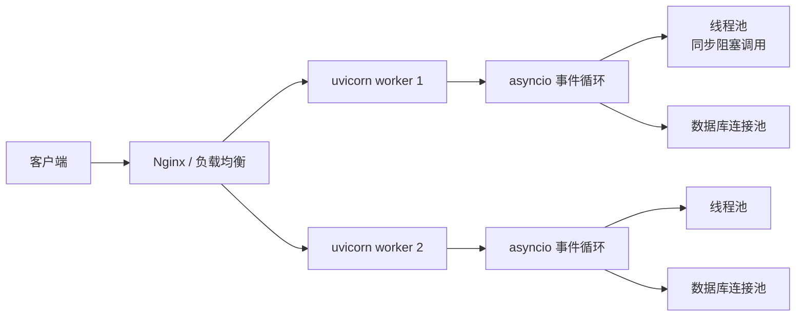

# Python 与操作系统

> Python 程序不是跑在真空里：它向操作系统要地址空间、线程、文件描述符和信号。理解这些，才能解释 GIL 为什么存在、`async` 为什么不阻塞、`multiprocessing` 为什么能绕开 GIL、文件描述符为什么会泄漏。

## 1. 一张总表

| 操作系统概念 | Python 接口 | 应用开发中的表现 |
|---|---|---|
| 进程 | `os.fork`、`multiprocessing`、`subprocess` | Web 服务的多 worker、CPU 密集任务隔离 |
| 线程 | `threading`、`concurrent.futures.ThreadPoolExecutor` | I/O 并发、GIL 竞争 |
| 协程 | `asyncio` | 高并发网络服务、WebSocket/SSE |
| 虚拟内存 / 堆 / 栈 | `mmap`、`resource`、`tracemalloc` | 内存占用、OOM、缓存 |
| 文件描述符 | `os.open`、`socket.fileno`、`selectors` | 连接泄漏、`Too many open files` |
| I/O 多路复用 | `select`/`poll`/`epoll`、`selectors`、`asyncio` | C10K、反向代理、数据库连接池 |
| 信号 | `signal` | 优雅停机、`SIGTERM`、`Ctrl+C` |
| 进程间通信 | `multiprocessing.Queue/Pipe/SharedMemory` | worker 池、任务分发、共享缓存 |
| 调度与时间 | `time`、`sched`、`asyncio` 事件循环 | 超时、重试、定时任务 |

## 2. 进程：隔离与并行

### 2.1 `fork` 与写时复制

在 Unix 上，`os.fork()` 创建一个子进程：父进程返回子进程 PID，子进程返回 `0`。

```python
import os

pid = os.fork()
if pid == 0:
    print("child", os.getpid())
    os._exit(0)
else:
    print("parent", os.getpid(), "child", pid)
    os.waitpid(pid, 0)
```

`fork` 之后父子进程拥有各自独立的地址空间，但采用**写时复制**：刚 fork 完并不复制物理内存，谁写谁复制。这让「fork 一个进程」比「重新加载整个解释器」便宜。

### 2.2 `multiprocessing` 的启动方式

| 平台 | 默认 start method | 特点 |
|---|---|---|
| Linux | `fork` | 快，但 fork 后线程状态可能不一致 |
| macOS（3.8+） | `spawn` | 重新启动解释器，安全但慢 |
| Windows | `spawn` | 只支持 `spawn`，必须保护入口 |

```python
import multiprocessing as mp

def work(x):
    return x * x

if __name__ == "__main__":          # spawn 模式必须有这行
    with mp.Pool(4) as pool:
        print(pool.map(work, range(8)))
```

`spawn` 会重新导入主模块，所以入口必须放在 `if __name__ == "__main__":` 下；否则子进程会递归创建进程。

### 2.3 `subprocess`：调用外部程序

```python
import subprocess

# 推荐：参数列表 + 不经过 shell
result = subprocess.run(
    ["ls", "-l"],
    capture_output=True,
    text=True,
    timeout=5,
    check=True,
)
print(result.stdout)
```

`shell=True` 会把字符串交给 shell 解释，用户可控的输入容易变成命令注入。除非确实需要管道、通配符等 shell 特性，否则保持默认的 `shell=False`。

## 3. 线程与 GIL

### 3.1 Python 线程就是操作系统线程

`threading.Thread` 最终调用平台的线程 API（Linux 的 pthread、Windows 的线程）。所以线程的创建、调度、上下文切换都由操作系统负责；Python 额外加了一把 **GIL**。

### 3.2 GIL 到底限制了什么

CPython 的传统构建里，同一时刻只有一个线程能执行 Python 字节码。GIL 的保护对象是解释器内部状态（引用计数、对象分配、GC 等），不是你的业务数据。

一个常见的过时说法是「每执行 100 条字节码切换一次」。从 Python 3.2 起，GIL 的切换已经改成**按时间片**：

```python
import sys
print(sys.getswitchinterval())     # 默认 0.005 秒
sys.setswitchinterval(0.001)       # 调小，切换更频繁
```

GIL 的关键行为：

- **CPU 密集型**：多线程基本跑不满多核，因为同一时刻只有一个线程在执行字节码。
- **I/O 密集型**：线程在 `read`、`recv`、`sleep` 等系统调用阻塞时会**释放 GIL**，其他线程可以继续跑，所以多线程仍然有效。
- **C 扩展**：NumPy 等库在执行耗时计算时可能主动释放 GIL，这时多线程能真正并行。

```python
from concurrent.futures import ThreadPoolExecutor, ProcessPoolExecutor

# I/O 密集：线程池
with ThreadPoolExecutor(max_workers=8) as ex:
    results = list(ex.map(fetch_url, urls))

# CPU 密集：进程池
with ProcessPoolExecutor(max_workers=4) as ex:
    results = list(ex.map(heavy_compute, data))
```

### 3.3 GIL 不等于线程安全

GIL 只保证「字节码之间」不并行，不保证复合操作原子。`count += 1` 会编译成「读、加、写」多条字节码，线程切换可能发生在中间：

```python
import threading

count = 0
lock = threading.Lock()

def inc():
    global count
    for _ in range(100000):
        with lock:          # 没有锁，结果通常小于 200000
            count += 1
```

需要共享可变状态时，仍然要用 `Lock`、`RLock`、`queue.Queue` 或不可变数据。

### 3.4 自由线程构建

Python 3.13 提供实验性的 **free-threaded build**（PEP 703），可以关闭 GIL。它不是「自动变快」：没有 GIL 之后，引用计数和容器操作需要更细的锁，业务代码里的竞态反而更容易暴露；同时 C 扩展需要重新编译并声明线程安全。生产环境是否采用，要看依赖生态。

## 4. 协程：单线程里的并发

`asyncio` 是**协作式**并发：一个线程跑事件循环，协程在 `await` 处主动让出控制权。它适合「大量连接、每个连接大部分时间在等 I/O」的场景。

```python
import asyncio

async def fetch(name, delay):
    await asyncio.sleep(delay)
    return f"{name} done"

async def main():
    async with asyncio.TaskGroup() as tg:      # 3.11+
        t1 = tg.create_task(fetch("a", 1))
        t2 = tg.create_task(fetch("b", 2))
    print(t1.result(), t2.result())

asyncio.run(main())
```

### 4.1 阻塞调用会卡住整个循环

事件循环是单线程的。在协程里调用 `time.sleep()`、`requests.get()`、同步数据库驱动，会阻塞整个 loop，所有协程一起停摆。

```python
import asyncio
import time
import requests

async def bad():
    time.sleep(5)              # 整个事件循环停 5 秒
    requests.get("https://example.com")   # 同样会阻塞

async def good():
    await asyncio.sleep(5)     # 让出控制权
    await asyncio.to_thread(requests.get, "https://example.com")  # 3.9+
```

CPU 密集任务也不应该直接放在协程里；用 `asyncio.to_thread`、`run_in_executor` 或进程池。

### 4.2 超时与取消

```python
async def main():
    try:
        async with asyncio.timeout(3):     # 3.11+
            await slow_operation()
    except TimeoutError:
        print("timed out")
```

取消是协作式的：协程需要在 `await` 点响应 `CancelledError`，并做好资源清理（关闭连接、释放锁）。

## 5. 内存：虚拟地址空间里的 Python 堆

### 5.1 进程的内存分区

```text
高地址
  ┌──────────────┐
  │   栈 stack    │  C 函数调用帧、局部变量（不是 Python 对象）
  ├──────────────┤
  │   堆 heap     │  malloc / pymalloc / 大块 mmap
  ├──────────────┤
  │   .bss/.data  │  全局变量、静态数据
  ├──────────────┤
  │   .text       │  机器码
  └──────────────┘
低地址
```

Python 对象全部在**堆**上，不在 C 栈上。C 栈只保存 `PyObject*` 这类临时引用；Python 层的帧和求值栈由解释器自己管理，里面放的也是引用。

### 5.2 `pymalloc` 的分层

CPython 对小块对象有一套自己的分配器：

```text
arena（64 位 3.12+ 默认 1 MiB）
  └─ pool（16 KiB）
      └─ block（16/32/48/…/512 B，共 32 个 size class）
```

- ≤ 512 字节：走 `pymalloc`，从对应 size class 的 free list 取 block；
- > 512 字节：交给 `malloc`/`mmap`；
- 释放：block 回到 pool 的 free list，**不保证立刻还给操作系统**；arena 只有全部空闲时才可能被释放。

这就是「删了很多对象，进程 RSS 却没降」的常见原因：内存回到了 Python 的空闲链，但没有回到 OS。

```python
import sys
sys._debugmallocstats()      # 只对 pymalloc 构建有效
```

本机 3.13 的输出片段：

```text
Small block threshold = 512, in 32 size classes.
2 arenas * 1048576 bytes/arena
23 unused pools * 16384 bytes
```

注意：arena/pool 的大小随版本和平台变化，老版本或 32 位构建常见的是 256 KiB / 4 KiB，**不要把某一版实测当成常量**。

### 5.3 引用计数与 GC

- 每个对象头里有 `ob_refcnt`；强引用加减，归零时调用类型自己的 `tp_dealloc`。
- 循环引用无法靠计数归零，需要**分代 GC**；GC 只跟踪容器类对象（list、dict、set、自定义类等），int/str 不参与。
- 3.12+ 有不朽对象（immortal objects），`sys.getrefcount(1)` 会返回一个极大的数，不再随引用变化。

```python
import gc
print(gc.get_threshold())    # 本机 3.13：(2000, 10, 10)，默认值随版本变
gc.collect()                 # 手动触发一次完整回收
```

### 5.4 观测内存

| 工具 | 看什么 | 局限 |
|---|---|---|
| `sys.getsizeof(x)` | 对象自身直接占用 | 不递归，不含引用对象 |
| `tracemalloc` | Python 层的分配快照与差异 | 看不到 C 扩展的 malloc |
| `psutil.Process().memory_info().rss` | 进程实际驻留内存 | 包含解释器、C 库、mmap |
| `resource.getrusage` | 峰值 RSS 等 | 粗粒度 |
| `gc.get_objects()` | 被 GC 跟踪的对象 | 只含容器类 |

```python
import tracemalloc

tracemalloc.start()
snap1 = tracemalloc.take_snapshot()
# ... 跑一段业务 ...
snap2 = tracemalloc.take_snapshot()
for stat in snap2.compare_to(snap1, "lineno")[:5]:
    print(stat)
```

### 5.5 `mmap` 与共享内存

`mmap` 把文件或匿名内存映射进地址空间，适合大文件随机读写和进程间共享：

```python
import mmap

with open("big.bin", "rb") as f:
    with mmap.mmap(f.fileno(), 0, access=mmap.ACCESS_READ) as mm:
        print(mm[:4])
```

多进程共享大块数据时，`multiprocessing.shared_memory.SharedMemory` 可以避免 pickle 整个数组；NumPy 数组可以直接挂到共享内存上。

## 6. 文件描述符与 I/O 多路复用

### 6.1 fd 是什么

在 Unix 里，「一切皆文件」：普通文件、socket、管道、终端都有文件描述符（一个非负整数）。进程有上限：

```python
import resource
soft, hard = resource.getrlimit(resource.RLIMIT_NOFILE)
print(soft, hard)
```

泄漏的典型形态是「打开了文件/socket/数据库连接，异常路径没有关闭」。用 `with` 或 `try/finally`：

```python
with open("data.txt") as f:
    data = f.read()

# socket 也一样
with socket.create_connection(("example.com", 80)) as s:
    ...
```

### 6.2 `select` / `poll` / `epoll`

阻塞 I/O 的问题是一个线程只能等一个 fd。I/O 多路复用让一个线程同时等多个 fd：

- `select`：跨平台，fd 数量有限；
- `poll`：没有 fd 数量上限，但仍要线性扫描；
- `epoll`（Linux）：事件驱动，适合大量连接；macOS 对应 `kqueue`。

Python 的 `selectors` 会自动选择当前平台最优的实现：

```python
import selectors
import socket

sel = selectors.DefaultSelector()
server = socket.socket()
server.bind(("127.0.0.1", 9000))
server.listen()
server.setblocking(False)

sel.register(server, selectors.EVENT_READ, data="accept")

while True:
    for key, mask in sel.select():
        if key.data == "accept":
            conn, addr = key.fileobj.accept()
            conn.setblocking(False)
            sel.register(conn, selectors.EVENT_READ, data="echo")
        else:
            conn = key.fileobj
            data = conn.recv(4096)
            if data:
                conn.sendall(data)
            else:
                sel.unregister(conn)
                conn.close()
```

`asyncio` 在底层就是「事件循环 + `epoll`/`kqueue` + 非阻塞 socket」。所以它不是魔法，只是把「注册 fd、等待事件、回调协程」这套流程封装了起来。

## 7. 信号：优雅停机

信号是 OS 发给进程的异步通知。Python 里用 `signal` 注册处理函数：

```python
import signal
import sys

def handle_term(signum, frame):
    print("shutting down...")
    # 停止接收新请求、关闭连接池、刷新日志
    sys.exit(0)

signal.signal(signal.SIGTERM, handle_term)
```

几个约束：

- 处理函数在**主线程**执行；工作线程里注册无效。
- `SIGINT` 默认转成 `KeyboardInterrupt`；`SIGTERM` 默认直接终止进程。
- 在 Kubernetes/容器里，删除 Pod 会先发 `SIGTERM`，等待一段时间再 `SIGKILL`；所以优雅停机逻辑要在这段时间内完成。
- `uvicorn`、`gunicorn` 已经内置了信号处理，自己再注册时要避免覆盖。

## 8. 进程间通信

| 方式 | 接口 | 特点 |
|---|---|---|
| 队列 | `multiprocessing.Queue` | 基于 pickle，适合传任务/结果；有后台 feeder 线程 |
| 管道 | `multiprocessing.Pipe` | 双向/单向，轻量；需要自己处理消息边界 |
| 共享内存 | `multiprocessing.shared_memory` | 零拷贝，适合大数组；要自己同步 |
| socketpair | `socket.socketpair()` | 本机双向字节流，可配合 `selectors`/`asyncio` |

```python
import multiprocessing as mp

def worker(q):
    while (item := q.get()) is not None:
        q.task_done()
        print("got", item)

if __name__ == "__main__":
    q = mp.Queue()
    p = mp.Process(target=worker, args=(q,))
    p.start()
    for i in range(3):
        q.put(i)
    q.put(None)
    p.join()
```

坑：

- `Queue` 用 pickle 序列化，lambda、打开的文件、数据库连接都传不过去。
- 子进程向 `Queue` 写完数据后要 `join()`，否则可能丢数据；反过来，父进程先 `join()` 再取结果也可能死锁。
- `SharedMemory` 不会自动回收，结束时需要 `close()` + `unlink()`。

## 9. 一个 Web 服务的 OS 视角



一次请求大致经历：

1. Nginx 接受连接，按 `worker` 分发；
2. 每个 `uvicorn` worker 是一个**进程**，进程里跑一个事件循环；
3. `async def` 端点直接在循环上执行；`def` 端点被 AnyIO 丢进线程池；
4. 同步数据库驱动会占用线程池，异步驱动才真正让出循环；
5. 请求结束，连接回到 keep-alive 或关闭；fd 回到空闲池；
6. 收到 `SIGTERM` 后停止 accept，等待在途请求，关闭连接池。

几个容量参数要对齐：

- `--workers` 通常按 CPU 核数设置，但容器里 `os.cpu_count()` 可能看到宿主机核数，实际受 cgroup quota 限制；
- `ulimit -n` 限制 fd 数，keep-alive 连接越多，需要越多 fd；
- 数据库连接池不是越大越好，池子超过数据库的 `max_connections` 会把数据库拖死；
- 线程池大小要覆盖同步阻塞调用的并发，不能按 CPU 核数设。

## 10. 常见坑与动手实验

### 常见坑

- **fork 之后又开线程**：子进程只继承调用 fork 的那个线程，其他线程的锁状态可能不一致，容易死锁。用 `spawn` 或 `forkserver`。
- **在 async 里调用同步库**：`requests`、`time.sleep`、同步 ORM 都会阻塞事件循环。
- **`multiprocessing` 传不可 pickle 的对象**：lambda、连接、锁、生成器。
- **fd 泄漏**：异常路径没有 `close`，最终 `Too many open files`。
- **`shell=True` 拼接用户输入**：命令注入。
- **把 `os.cpu_count()` 当成容器可用核数**：cgroup 限制下会高估。

### 动手实验

```python
import os
import time
import threading
import asyncio

# 1. 进程与线程
print("pid", os.getpid(), "threads", threading.active_count())

# 2. GIL：CPU 密集 vs I/O 密集
def cpu():
    n = 0
    for _ in range(10_000_000):
        n += 1
    return n

def io():
    time.sleep(0.1)

t0 = time.perf_counter()
threads = [threading.Thread(target=cpu) for _ in range(4)]
for t in threads: t.start()
for t in threads: t.join()
print("4 threads cpu:", time.perf_counter() - t0)   # 接近串行

t0 = time.perf_counter()
threads = [threading.Thread(target=io) for _ in range(4)]
for t in threads: t.start()
for t in threads: t.join()
print("4 threads io:", time.perf_counter() - t0)    # 接近 0.1s

# 3. asyncio：同样等 0.1s，4 个协程并发
async def main():
    t0 = time.perf_counter()
    await asyncio.gather(*(asyncio.sleep(0.1) for _ in range(4)))
    print("4 coroutines:", time.perf_counter() - t0)

asyncio.run(main())
```

### 观察命令

```bash
ps -o pid,ppid,nlwp,rss,cmd -p <pid>   # 线程数、RSS
ls /proc/<pid>/fd | wc -l              # fd 数量
ss -s                                  # 套接字统计
strace -f -p <pid>                     # 跟踪系统调用（需权限）
```

## 11. 小结

- **进程**给隔离和真正的并行，**线程**给 I/O 并发但受 GIL 限制，**协程**在单线程里用 `await` 做协作式切换。
- GIL 是 CPython 解释器的锁，不是业务锁；CPU 密集用多进程，I/O 密集用线程或协程。
- Python 对象在私有堆上，C 栈和解释器帧只保存引用；`pymalloc` 管小块，大块走 `malloc`/`mmap`。
- fd 是有限资源，I/O 多路复用让一个线程等多个 fd；`asyncio` 底层就是 `epoll`/`kqueue`。
- 信号决定进程怎么优雅退出；容器里的 `SIGTERM` 处理不好，就会丢请求。
