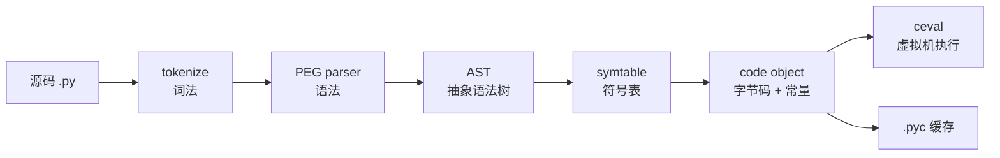

# Python 与编译原理

> Python 不是「直接解释源码」：它先把源码编译成字节码，再由虚拟机执行。理解这条管线，才能解释局部变量为什么比全局变量快、装饰器到底在什么时候执行、`import` 除了执行模块还做了什么。
>
> 本篇偏「语言机制与执行模型」（AST、字节码、闭包、import）；编译器后端/JIT 的细节不展开，JVM 的 C1/C2 见 [Java 与编译原理](../Java与计算机基础/编译原理.md)。

## 1. 一条完整的编译管线



| 阶段 | 产物 | Python 接口 |
|---|---|---|
| 词法 | token 流 | `tokenize` |
| 语法 | AST | `ast.parse` |
| 符号表 | 名字的作用域信息 | `symtable` |
| 编译 | code object | `compile` |
| 执行 | 字节码逐条执行 | `exec` / `eval` / 函数调用 |
| 缓存 | `.pyc` | `__pycache__` |

Python 的「解释执行」指的是最后一步：字节码由 `ceval.c` 的主循环逐条执行，而不是把源码逐行翻译成机器码。

## 2. AST：源码的结构化表示

```python
import ast

tree = ast.parse("x = 1 + 2")
print(ast.dump(tree, indent=2))
```

输出（为排版压缩了换行，字段未省略）：

```text
Module(
  body=[
    Assign(
      targets=[Name(id='x', ctx=Store())],
      value=BinOp(
        left=Constant(value=1),
        op=Add(),
        right=Constant(value=2)))])
```

AST 是「语法结构」，不是「执行计划」。同一个 AST 可以：

- 编译成字节码：`compile(tree, "<s>", "exec")`；
- 做静态检查：类型检查、lint、安全扫描；
- 做代码转换：装饰器、宏、DSL、自动重构。

```python
code = compile("x = 1 + 2", "<demo>", "exec")
print(code.co_consts)      # (3, None)：编译器已经做了常量折叠
exec(code, {})
```

`co_consts` 里出现 `3` 而不是 `1`、`2`，说明编译期会做常量折叠；`co_names`、`co_varnames`、`co_freevars`、`co_cellvars` 则记录名字与作用域信息。

## 3. 字节码：栈式虚拟机的指令

Python 虚拟机是**栈式**的：指令从栈上取操作数，把结果压回栈。用 `dis` 看一个最简单的函数：

```python
import dis

def add(a, b):
    return a + b

dis.dis(add)
```

3.11 / 3.12 的输出大致是：

```text
  2           RESUME                   0
              LOAD_FAST                0 (a)
              LOAD_FAST                1 (b)
              BINARY_OP                0 (+)
              RETURN_VALUE
```

3.13 会把相邻的两个 `LOAD_FAST` 融合成一条：

```text
  2           RESUME                   0
              LOAD_FAST_LOAD_FAST      1 (a, b)
              BINARY_OP                0 (+)
              RETURN_VALUE
```

逐条读：

- `RESUME`：函数入口，通知解释器可以开始执行/自适应；跑热后可能变成 `RESUME_CHECK`；
- `LOAD_FAST 0`：把第 0 个局部变量压栈；
- `LOAD_FAST 1`：把第 1 个局部变量压栈（3.13 融合成 `LOAD_FAST_LOAD_FAST`）；
- `BINARY_OP +`：弹出两个值，相加，压回结果；
- `RETURN_VALUE`：弹出栈顶作为返回值。

常见指令：

| 指令 | 含义 |
|---|---|
| `LOAD_CONST` | 加载常量（数字、字符串、`None`） |
| `LOAD_FAST` | 加载局部变量（数组下标访问） |
| `LOAD_GLOBAL` | 加载全局变量（字典查找，3.11+ 有内联缓存） |
| `LOAD_DEREF` | 加载闭包变量（cell：存闭包变量的专用小对象，函数定义与执行的时机解耦了，多个函数通过引用同一个 cell 共享该变量） |
| `LOAD_ATTR` | 加载属性 |
| `STORE_FAST` | 写入局部变量 |
| `BINARY_OP` | 二元运算（3.11+） |
| `CALL` | 调用函数（3.11+，具体前缀随版本变） |
| `RETURN_VALUE` | 返回 |

3.11 起有**自适应 specialization**：热点指令会被替换成更具体的版本（例如 `BINARY_OP_ADD_INT`、`LOAD_ATTR_MODULE`）。注意三点：

- `dis.dis()` 默认 `show_caches=False`，**不会显示 `CACHE`**；要 `dis.dis(f, show_caches=True)` 才看得到内联缓存占位。
- `adaptive=True` 只对**已经预热**的 code object 有效；冷函数即使传 `adaptive=True` 仍显示基础指令。
- 具体融合/特化指令随版本变化，示例只保证语义，不保证每条指令的编号一致。

## 4. 名字查找：LEGB 与四种加载

Python 查找名字的顺序是 **L**ocal → **E**nclosing → **G**lobal → **B**uiltin：

```python
x = "global"

def outer():
    x = "enclosing"
    def inner():
        print(x)        # 找到 enclosing
    return inner
```

编译期会决定每个名字用哪种加载指令：

| 名字位置 | 指令 | 存储 |
|---|---|---|
| 函数局部变量 | `LOAD_FAST` | 帧的 fast locals 数组 |
| 闭包变量 | `LOAD_DEREF` | cell 对象 |
| 模块全局 | `LOAD_GLOBAL` | 模块 `__dict__` |
| 内置名字 | `LOAD_GLOBAL`（回退 builtins） | `builtins.__dict__` |

```python
def outer():
    x = 1
    def inner():
        return x
    return inner

f = outer()
print(f.__code__.co_freevars)     # ('x',)
print(outer.__code__.co_cellvars) # ('x',)
```

`global` 让赋值落到模块全局；`nonlocal` 让赋值落到外层函数的 cell。没有声明时，函数内赋值默认创建局部变量——这也是「在函数里改全局变量要写 `global`」的编译期原因。

### 4.1 闭包是「按引用捕获」

```python
def make_funcs():
    funcs = []
    for i in range(3):
        funcs.append(lambda: i)
    return funcs

print([f() for f in make_funcs()])   # [2, 2, 2]，不是 [0, 1, 2]
```

循环变量 `i` 在函数作用域里是一个 cell，三个 lambda 都引用它；循环结束时 `i = 2`。在模块级写同样的循环时，`i` 是模块全局变量（`LOAD_GLOBAL`），行为一样但机制不同。要固定当前值，用默认参数：

```python
funcs = [lambda i=i: i for i in range(3)]
```

## 5. 函数、默认参数与装饰器

### 5.1 默认参数只求值一次

```python
def append_to(x, acc=[]):     # acc 在函数定义时创建一次
    acc.append(x)
    return acc

print(append_to(1))           # [1]
print(append_to(2))           # [1, 2]
```

默认值在 `def` 执行时求值，之后每次调用复用同一个对象。需要「每次新建」时用 `None` 哨兵：即以 `None` 作为占位值，函数体内检测到 `None` 就自行创建默认对象，从而把「默认值何时创建」推迟到每次调用。

```python
def append_to(x, acc=None):
    if acc is None:
        acc = []
    acc.append(x)
    return acc
```

### 5.2 装饰器是「函数调用」

```python
@decorator
def f():
    ...
```

等价于：

```python
def f():
    ...
f = decorator(f)
```

多个装饰器从下往上应用：

```python
@a
@b
def f():
    ...
# f = a(b(f))
```

装饰器在**函数定义时**执行一次，不是每次调用都执行；带参数的装饰器还多一层：

```python
@repeat(3)
def hello():
    print("hi")

# 等价于 hello = repeat(3)(hello)
```

`functools.wraps` 把原函数的 `__name__`、`__doc__`、`__module__`、`__qualname__`、`__annotations__`、`__dict__` 复制到包装函数，并设置 `__wrapped__`，否则调试、文档和框架反射都会拿到 `wrapper`。

## 6. `import`：不只是「执行一个文件」

`import pkg.mod` 大致经历：

1. 查 `sys.modules`，已加载就直接返回；
2. 沿 `sys.meta_path` 找 finder（最常见的是 `PathFinder`）；
3. finder 在 `sys.path` 里找模块，返回 loader；
4. 创建 module 对象，**先放进 `sys.modules`**；
5. 执行模块代码（包的话先执行 `__init__.py`）；
6. 在父包上设置子模块属性，并按 `import` 形式绑定名字。

第 4 步必须在第 5 步之前：否则循环导入时，B 根本看不到「部分初始化的 A」。另外，`import pkg.mod` 在当前命名空间绑定的是 `pkg`，不是 `mod`；`from pkg import mod` 才绑定 `mod`。

```python
import sys
import importlib

mod = importlib.import_module("json")
print(mod is sys.modules["json"])    # True
```

几个容易误解的点：

- **`import` 只执行一次**：第二次导入命中 `sys.modules`，不会重新执行模块顶层代码。需要重新加载用 `importlib.reload()`，但它不会重跑已经引用旧对象的代码。
- **`.pyc` 只是缓存**：它跳过词法/语法/编译，不加速运行时的字节码执行；`.pyc` 失效由源码 mtime/size 或哈希决定。
- **`sys.path[0]` 是脚本目录或当前目录**：不是「包所在目录」；部署时要明确工作目录和 `PYTHONPATH`。
- **命名空间包**（PEP 420）：没有 `__init__.py` 的目录也可以成为包，多个目录可以合并同一个包名。
- **循环导入**：A 导入 B、B 又导入 A 时，B 看到的是「部分初始化」的 A；把导入移到函数内、或重构依赖方向，通常比 `try/except ImportError` 更可靠。

## 7. `exec`、`eval` 与 `compile`

```python
code = compile("1 + 2", "<expr>", "eval")
print(eval(code))                 # 3

exec("x = 1 + 2", {})             # 执行语句
```

- `eval` 只接受表达式，返回一个值；
- `exec` 执行语句块，返回 `None`；
- `compile` 把源码/AST 编译成 code object，模式有 `exec`、`eval`、`single`。

**永远不要 `eval` 不可信输入**：它能访问内置函数、导入模块、执行任意代码。解析字面量用 `ast.literal_eval`：

```python
import ast
ast.literal_eval("{'a': [1, 2]}")   # 只允许字面量
```

## 8. 用字节码解释性能差异

| 写法 | 字节码层面的原因 | 建议 |
|---|---|---|
| 局部变量 vs 全局变量 | `LOAD_FAST` 是数组下标；`LOAD_GLOBAL` 要查模块字典 | 热循环里把全局/属性缓存到局部 |
| `for` vs `while` | `for` 用 `FOR_ITER` 在 C 层推进迭代器 | 遍历可迭代对象优先 `for` |
| 列表推导式 vs 循环 `append` | 推导式有专门的 `LIST_APPEND` 路径，3.12 起还会内联 | 简单映射/过滤用推导式 |
| 字符串 `+=` 循环 | 最坏 O(n²)；CPython 对唯一引用的 `str` 会原地扩容，常见循环接近 O(n) | 仍建议 `"".join(parts)`，跨实现更稳 |
| 属性反复访问 | 每次 `LOAD_ATTR` 都要查类型/描述符 | 热循环里缓存到局部变量 |
| 重复计算 | 每次都重新执行函数体 | `functools.lru_cache(maxsize=...)` |
| 大列表一次物化 | 峰值内存高 | 生成器/迭代器 |

一个对比例子：

```python
import dis

GLOBAL_LIST = list(range(1000))

def global_sum():
    total = 0
    for i in range(len(GLOBAL_LIST)):
        total += GLOBAL_LIST[i]
    return total

def local_sum():
    data = GLOBAL_LIST
    total = 0
    for i in range(len(data)):
        total += data[i]
    return total

dis.dis(global_sum)
dis.dis(local_sum)
```

`global_sum` 每轮都要 `LOAD_GLOBAL` 取 `GLOBAL_LIST`；`local_sum` 先把 `GLOBAL_LIST` 绑到局部 `data`，循环里用 `LOAD_FAST`。3.11+ 的 `LOAD_GLOBAL` 有内联缓存，差距比 3.10 小，但在热循环里仍然存在；别为了微优化牺牲可读性。

## 9. 常见坑

- **默认参数用可变对象**：`def f(x, acc=[])` 的 `acc` 只创建一次。
- **闭包晚绑定**：循环里的 lambda 捕获的是同一个变量，不是当时的值。
- **装饰器顺序搞反**：`@a` 在 `@b` 上面，实际是 `a(b(f))`。
- **`__pycache__` 不是加速器**：它只省去编译，不改变运行时。
- **循环导入**：顶层互相导入，拿到半成品模块。
- **`eval` 处理用户输入**：直接执行任意代码。
- **把 `import` 当免费操作**：首次导入会执行模块顶层代码，可能有 I/O、网络、全局初始化。
- **`from module import name` 后重新赋值**：绑定的是导入时的对象，模块后续更新不会同步到本地名字。

## 10. 动手实验

```python
import ast
import dis
import sys

# 1. 看 AST
print(ast.dump(ast.parse("x = 1 + 2"), indent=2))

# 2. 看字节码
def add(a, b):
    return a + b

dis.dis(add)

# 3. 看常量折叠
code = compile("x = 1 + 2", "<demo>", "exec")
print(code.co_consts)          # (3, None)

# 4. 看闭包
def outer():
    x = 1
    def inner():
        return x
    return inner

print(outer().__code__.co_freevars)

# 5. 看模块缓存
import json
print(json is sys.modules["json"])
```

## 11. 小结

- Python 的执行链路是 **源码 → AST → code object → 字节码 → 虚拟机**；`.pyc` 缓存的是编译结果。
- 字节码是栈式指令；`LOAD_FAST`/`LOAD_GLOBAL`/`LOAD_DEREF` 的差异对应局部、全局、闭包三种存储。
- 默认参数在定义时求值，装饰器在定义时执行，闭包按引用捕获——这三个特性解释了大多数「反直觉」行为。
- `import` 的核心是 `sys.modules` + finder/loader；`.pyc` 只省编译，不省执行。
- `exec`/`eval` 是强大但危险的元编程工具；不可信输入一律用 `ast.literal_eval` 或专门的解析器。
