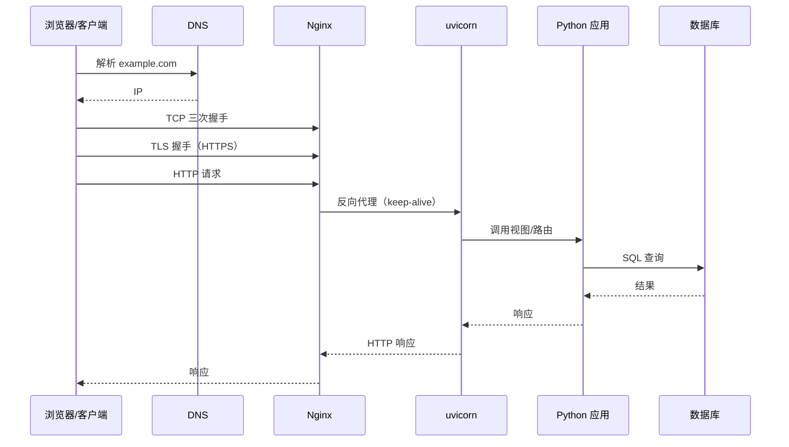

# Python 与计算机网络

> Python 的 `socket` 是操作系统 socket 的薄封装；`requests`、`httpx` 只是在其上做 HTTP 协议解析。把协议栈和 Python API 对上，排障才不会只靠猜。

## 1. 一张总表

| 网络层次 | 代表协议 | Python 载体 | 应用开发中的表现 |
|---|---|---|---|
| 应用层 | HTTP/HTTPS、WebSocket、SSE、DNS | `http.client`、`urllib`、`requests`、`httpx`、`websockets`、`dnspython` | API 调用、Web 服务、推送 |
| 传输层 | TCP、UDP | `socket`、`asyncio` streams | 连接、可靠性、粘包 |
| 网络层 | IP、ICMP | `socket`、`subprocess` 调 `ping` | 路由、连通性 |
| 链路层 | Ethernet、Wi-Fi | 由 OS 负责 | 一般不需要 Python 介入 |

一个常见误解是「`requests` 是网络库」。它其实是**HTTP 客户端**：DNS、TCP、TLS 都由底层库和操作系统完成，`requests` 负责拼 HTTP 报文、解析响应、管理连接池。

## 2. TCP socket：可靠字节流

### 2.1 服务端与客户端

```python
# server.py
import socket

with socket.socket(socket.AF_INET, socket.SOCK_STREAM) as server:
    server.setsockopt(socket.SOL_SOCKET, socket.SO_REUSEADDR, 1)
    server.bind(("127.0.0.1", 9000))
    server.listen(128)                     # backlog：等待 accept 的队列长度
    print("listening on 9000")

    conn, addr = server.accept()           # 阻塞，直到有连接
    with conn:
        while True:
            data = conn.recv(4096)         # 可能只收到一部分
            if not data:
                break
            conn.sendall(data)             # sendall 负责把剩余字节发完
```

```python
# client.py
import socket

with socket.create_connection(("127.0.0.1", 9000), timeout=3) as s:
    s.sendall(b"hello")
    print(s.recv(4096))
```

### 2.2 `recv` 不保证一次读完

TCP 是**字节流**，没有消息边界。`recv(4096)` 可能返回 1 个字节，也可能返回 4096 个；对端调用两次 `send`，这边可能一次 `recv` 就全收到。应用层必须自己定边界。

最常见的两种做法：

```python
# 1) 长度前缀：先读 4 字节长度，再读 body
import struct

def send_frame(sock, payload: bytes):
    sock.sendall(struct.pack("!I", len(payload)) + payload)

def recv_frame(sock):
    header = recv_exact(sock, 4)
    (length,) = struct.unpack("!I", header)
    return recv_exact(sock, length)

def recv_exact(sock, n):
    buf = bytearray()
    while len(buf) < n:
        chunk = sock.recv(n - len(buf))
        if not chunk:
            raise ConnectionError("peer closed")
        buf.extend(chunk)
    return bytes(buf)
```

```python
# 2) 换行分隔：适合 JSON Lines / 日志流
# 发送端每条消息后加 b"\n"，接收端用 makefile().readline()
```

### 2.3 `send`、`sendall` 与 `close`

- `send()` 返回实际发送的字节数，可能小于传入长度；必须循环。
- `sendall()` 内部循环，直到发完或出错；业务代码优先用它。
- `close()` 关闭读写两端；`shutdown(socket.SHUT_WR)` 只关闭写方向，对端还能继续发数据，适合「发完请求但还要读响应」。
- `SO_REUSEADDR` 让服务端在重启时能复用 `TIME_WAIT` 的端口；`SO_REUSEPORT` 允许多个进程绑定同一端口（负载均衡）。
- `TCP_NODELAY` 关闭 Nagle 算法，减少小包延迟；对延迟敏感的 RPC 常开，但会增加小包数量。

## 3. UDP：数据报

UDP 保留消息边界，但不保证送达、顺序和去重：

```python
import socket

# 接收端
with socket.socket(socket.AF_INET, socket.SOCK_DGRAM) as s:
    s.bind(("127.0.0.1", 9001))
    data, addr = s.recvfrom(65535)
    print(addr, data)

# 发送端
with socket.socket(socket.AF_INET, socket.SOCK_DGRAM) as s:
    s.sendto(b"ping", ("127.0.0.1", 9001))
```

DNS 主要走 UDP 53（响应太大时回退 TCP）；实时音视频、游戏、指标上报也常用 UDP。需要可靠性时，要么在应用层做重传/序号，要么用 QUIC（它在用户态实现了可靠传输）。

## 4. HTTP：应用层协议

### 4.1 三个层次

| 方式 | 特点 | 适用 |
|---|---|---|
| `http.client` | 标准库，直接控制连接与请求 | 学习协议、简单脚本 |
| `urllib.request` | 标准库，处理 URL、重定向、认证 | 不想装第三方依赖 |
| `requests` | 同步、API 友好、连接池 | 大多数脚本和服务端同步调用 |
| `httpx` | 同步 + 异步、HTTP/2 | FastAPI/async 服务、需要统一客户端 |

### 4.2 必须显式设置超时

`requests` 默认**没有超时**，对端不响应时可能一直挂住：

```python
import requests

# 不推荐：没有超时
r = requests.get("https://example.com/api")

# 推荐：连接超时 3s，读取超时 10s
r = requests.get("https://example.com/api", timeout=(3, 10))
r.raise_for_status()
print(r.json())
```

`timeout` 是「连接」和「两次读之间」的超时，不是整个请求的总时长；下载大文件时总时长可能远超 `timeout`。

### 4.3 连接池与 Session

`requests.Session` 复用 TCP 连接，避免每次请求都重新握手：

```python
import requests

with requests.Session() as s:
    s.headers.update({"User-Agent": "my-app/1.0"})
    for url in urls:
        r = s.get(url, timeout=(3, 10))
        r.raise_for_status()
```

`httpx` 的 `AsyncClient` 同理：

```python
import httpx

async with httpx.AsyncClient(timeout=10) as client:
    r = await client.get("https://example.com/api")
    r.raise_for_status()
```

连接池不是越大越好：每个连接都占 fd 和服务端资源；池子超过对端承载能力，会把对方压垮。

### 4.4 TLS

HTTPS = HTTP over TLS。Python 侧通常不需要自己拼握手，但要知道验证开关：

```python
import ssl
import httpx

ctx = ssl.create_default_context()          # 加载系统 CA，验证主机名
r = httpx.get("https://example.com", verify=ctx)

# 千万不要在生产环境这样做
# httpx.get("https://example.com", verify=False)
```

`verify=False` 关闭证书校验，等于把中间人攻击的门打开；只应在本地自签名调试时临时使用。客户端证书（mTLS）通过 `cert=(certfile, keyfile)` 传入。

### 4.5 HTTP 的关键细节

- **keep-alive**：HTTP/1.1 默认复用连接；`Connection: close` 表示本次请求后关闭。
- **Content-Length / chunked**：有长度就按长度读，没有就用 `Transfer-Encoding: chunked`。
- **重定向**：`requests` 默认跟随 301/302/303/307/308；跨域重定向可能丢 `Authorization`，需要显式控制。
- **压缩**：`Accept-Encoding: gzip`，客户端自动解压；不要重复解压。
- **代理**：`HTTP_PROXY`/`HTTPS_PROXY` 环境变量会被 `requests` 读取；容器里经常因为代理配置访问失败。

## 5. `asyncio` 网络：单线程等大量连接

`asyncio` 把「非阻塞 socket + 事件循环」封装成流：

```python
import asyncio

async def handle(reader: asyncio.StreamReader, writer: asyncio.StreamWriter):
    while True:
        line = await reader.readline()      # 读到换行
        if not line:
            break
        writer.write(line.upper())
        await writer.drain()               # 背压：等发送缓冲可写
    writer.close()
    await writer.wait_closed()

async def main():
    server = await asyncio.start_server(handle, "127.0.0.1", 9002)
    async with server:
        await server.serve_forever()

asyncio.run(main())
```

客户端：

```python
async def main():
    reader, writer = await asyncio.open_connection("127.0.0.1", 9002)
    writer.write(b"hello\n")
    await writer.drain()
    print(await reader.readline())
    writer.close()
    await writer.wait_closed()
```

要点：

- `read(n)` 最多读 n 字节，可能更少；要定长用 `readexactly(n)`，要按行用 `readline()`。
- `drain()` 是背压：发送缓冲满了就等，避免一次性把内存撑爆。
- 一个协程阻塞（`time.sleep`、同步 HTTP、CPU 计算）会卡住整个 loop；用 `asyncio.to_thread` 或异步库。
- `asyncio.timeout(3)` 给一段代码加超时；`TaskGroup` 管理一组任务的生命周期。

## 6. DNS：名字到地址

```python
import socket

for family, socktype, proto, canonname, sockaddr in socket.getaddrinfo(
    "example.com", 443, type=socket.SOCK_STREAM
):
    print(family, sockaddr)
```

`getaddrinfo` 会读 `/etc/hosts`、DNS 配置，返回 IPv4/IPv6 候选。常见问题：

- **DNS 失败**：`socket.gaierror`，先检查域名、`/etc/resolv.conf`、代理。
- **IPv6 优先但不可达**：浏览器有 Happy Eyeballs，Python 客户端不一定有；可以显式指定 `family=AF_INET` 排查。
- **TTL 与缓存**：DNS 有 TTL，`requests`/`httpx` 的连接池也会复用连接，改 DNS 后不一定立刻生效。
- 需要查 MX/TXT/CNAME 等记录时用 `dnspython`，标准库只做地址解析。

## 7. 排障：从现象到命令

| 现象 | 可能原因 | 先看什么 |
|---|---|---|
| `ConnectionRefusedError` | 端口没监听、防火墙 reject | `ss -tulpn`、`lsof -i :8000` |
| `TimeoutError` | 防火墙 drop、服务过载、路由不通 | `curl -v`、`tcpdump`、`ping` |
| `ConnectionResetError` | 对端 RST、半开连接、代理断开 | `dmesg`、服务端日志、`tcpdump` |
| `socket.gaierror` | DNS 解析失败 | `getent hosts`、`nslookup` |
| 偶发超时 | 连接池耗尽、TIME_WAIT 太多、backlog 满 | `ss -s`、`netstat -s`、池指标 |
| HTTPS 证书错误 | CA、主机名、过期、代理 | `curl -v`、`openssl s_client` |

常用命令：

```bash
ss -tulpn                 # 监听端口与进程
ss -s                     # 套接字统计
lsof -i :8000             # 谁占了 8000
curl -v https://example.com
tcpdump -i any -n port 8000
nc -vz example.com 443    # 只测连通性
```

## 8. 一个请求的旅程



这条链路上，每一层都可能成为瓶颈：

- DNS 慢：首字节时间变长；
- TCP 握手慢：高延迟网络、TLS 证书链过长；
- Nginx worker 不足：连接排队；
- uvicorn worker 不足：请求排队；
- 同步数据库调用占满线程池：`async` 服务退化成串行；
- 连接池耗尽：请求等连接，表现为「偶发超时」。

### WebSocket 与 SSE

- **WebSocket**：一次 HTTP Upgrade 后变成全双工，适合聊天、协同编辑、实时游戏。
- **SSE（Server-Sent Events）**：服务端单向推送 `text/event-stream`，适合通知、进度条、日志流；比 WebSocket 简单，走普通 HTTP。

## 9. 常见坑

- **不设超时**：`requests` 默认无超时，服务端不响应会挂死。
- **以为 `recv` 一次就是一条消息**：TCP 是字节流，必须自己定边界。
- **用 `send` 而不是 `sendall`**：大块数据可能只发出去一部分。
- **在 async 里用同步 HTTP 客户端**：`requests` 会阻塞事件循环。
- **`verify=False` 上生产**：证书校验被关闭。
- **忽略代理环境变量**：容器里 `HTTP_PROXY` 可能把内网请求也代理走。
- **TIME_WAIT 太多**：短连接高频调用；用连接池、`SO_REUSEADDR`，并评估是否要长连接。
- **backlog 太小**：突发连接被拒；`listen()` 的参数要结合并发量。

## 10. 动手实验

```bash
# 1. 起一个本地 TCP echo 服务（用上面的 server.py）
python server.py

# 2. 另开终端，测连通性与延迟
nc -vz 127.0.0.1 9000
printf 'hello\n' | nc 127.0.0.1 9000    # 看 echo 是否返回

# 3. 看端口和连接状态
ss -tulpn | grep 9000
ss -tan state time-wait | wc -l

# 4. 抓包（需要权限）
tcpdump -i lo -n port 9000 -c 20
```

Python 侧：

```python
import socket
import time

# 测 DNS 解析耗时
t0 = time.perf_counter()
socket.getaddrinfo("example.com", 443)
print("dns:", time.perf_counter() - t0)

# 测 TCP 连接耗时
t0 = time.perf_counter()
with socket.create_connection(("example.com", 443), timeout=5):
    pass
print("tcp:", time.perf_counter() - t0)
```

## 11. 小结

- `socket` 是 OS socket 的封装，TCP 是**字节流**，没有消息边界；应用层要自己定帧。
- `sendall` 负责发完，`recv` 不保证一次读完；`close` 与 `shutdown` 语义不同。
- HTTP 客户端不是网络本身：DNS、TCP、TLS 都在它下面；`requests` 默认无超时。
- `asyncio` 是「单线程 + 非阻塞 socket + 事件循环」，适合大量等待 I/O 的连接；阻塞调用会卡住整个 loop。
- 排障先分层：DNS → TCP → TLS → HTTP → 应用，再用 `ss`、`curl -v`、`tcpdump` 逐层验证。
