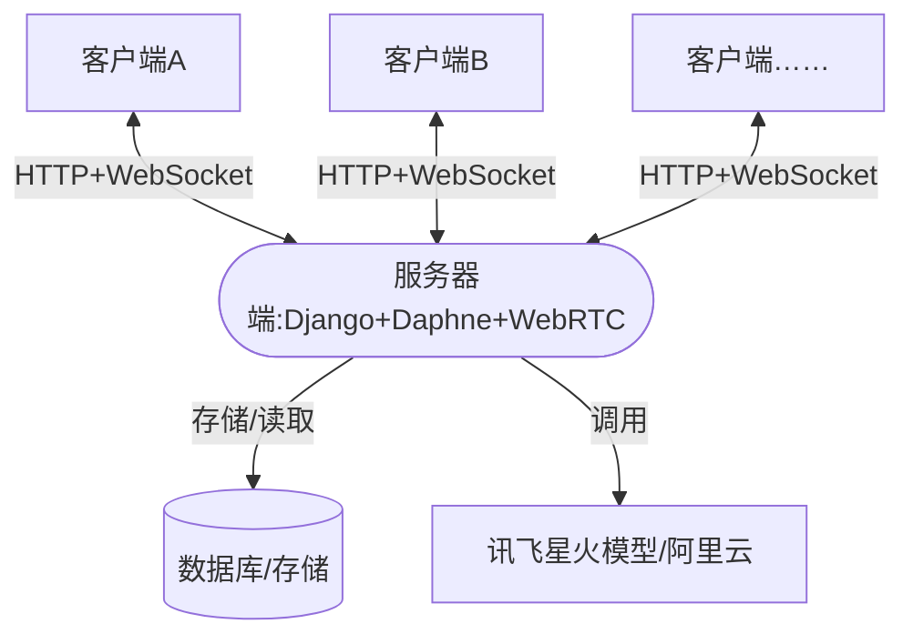
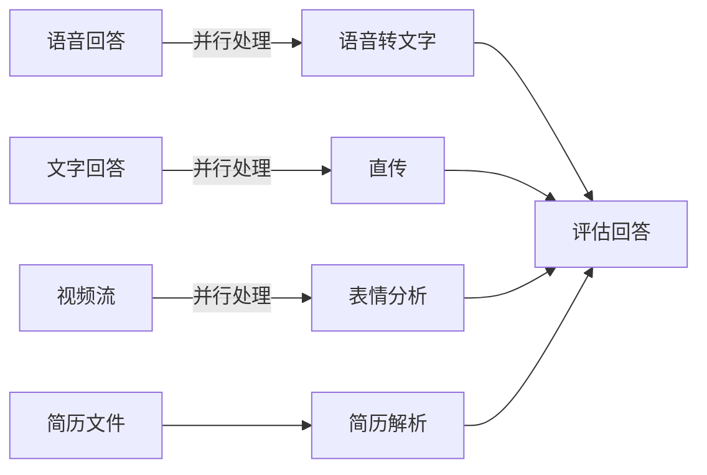

这是「中国软件杯」参赛项目在面试里的问答整理，顺序按面试官真正会追问的来：先讲为什么做、架构怎么拆，再讲 Django 的异步、WebSocket 分组通信与模型选型的取舍。

答案不是背下来的标准答案，而是当时实际怎么做的、以及事后觉得哪里可以更好。

项目介绍：可模拟真实面试场景，通过语音、视频、文本等多模态数据对学生面试表现进行智能评测，可生成含能力雷达图、关键问题定位及改进建议的可视化报告，并提供个性化学习路径推荐。
项目职责：基于Django 架构搭建实时通信服务，开发HTTP 接口与WebSocket 接口模块，实现客户端与服务器的音视频流双向传输；使用PostgreSQL 实现评测数据存储与检索；调用讯飞星火/ 千问大模型接口生成面试问题与评测分析结果。
## 面试
### 简要介绍项目
这个项目主要针对我自己这种正在求职的大学生，功能是通过AI评测来提升简历水平和面试表现。我主要负责后端部分，基于 Django+Channels 搭建实时通信服务，模型方面直接调用讯飞星火大模型和阿里的千问大模型，做到生成面试问题、生成面试评测报告、根据面试评测结果进行个性化资源推荐这三个主要功能，最后受限于我个人的精力投入和水平，整体效果一般。

为什么做这个项目？主要有两个原因，在需求方面，想到自己很快就要找工作，所以希望有一个工具能够帮助自己提升简历和面试。在技术方面，个人比较了解多模态大模型。
### Django与异步架构
Django本身并非为高并发、长连接的实时应用设计。请详细阐述你**具体的架构方案**：
主要是使用Channel库，是Django 的异步扩展框架。（channel库的技术原理？作用？）
- Channel：是异步任务 / 消息的 “传输管道”，每个 WebSocket 连接、每个异步任务都会对应一个独立的 Channel，消息按 “生产者 - 消费者” 模式在 Channel 中传递；
- Channel Layer：是多个 Channel 之间的 “消息路由器”，负责跨 Channel、跨进程 / 服务器同步消息，你项目中用 “内存” 作为后端，本质是把消息存在当前进程的内存中，而 Redis 则是把消息存在分布式缓存中。
Django 原生基于 WSGI（同步、短连接），我替换为**ASGI（Asynchronous Server Gateway Interface）** 作为通信网关，使用`Daphne`（Channels 官方推荐）作为主 ASGI 服务器，在`settings.py`中配置`CHANNEL_LAYERS`，采用内存作为通道层（Channel Layer）的后端存储（没有使用Redis，因为开发时间紧。）**通道层是用来做什么的？**
- **分组通信**：你给每个面试用户创建了`interview_{user_id}`的分组（Group），Channel Layer 能把音视频流数据精准推送给该分组下的所有连接（比如AI面试官端和学生端的连接）；
- **消息转发**：WebSocket Consumer 接收的音视频二进制数据，通过 Channel Layer 转发给异步任务处理（而非直接在 Consumer 里处理），避免阻塞长连接；
- **状态同步**：比如学生端断连后，服务端能通过 Channel Layer 通知AI面试官端 “连接中断”，保证多端状态一致。

使用了sync_to_async ，含义是什么？为什么要用
`sync_to_async`是`asgiref`库（Django/Channels 官方依赖）提供的工具，核心作用是**将同步阻塞的函数 / 代码，封装为异步非阻塞的协程**，让同步代码能运行在 ASGI 的异步事件循环中。
ASGI 的事件循环是**单线程（或少量线程）的异步模型**，而Django 原生的 ORM 操作（比如 PostgreSQL 的增删改查）、第三方接口调用（比如讯飞星火 / 千问的 HTTP 请求）都是 “同步阻塞” 的 —— 代码执行到这一步，必须等结果返回才能继续，而 ASGI 的异步事件循环最怕 “阻塞”（一阻塞就会导致所有长连接卡壳）；sync_to_async能把这些同步代码 “包装” 成异步代码，让事件循环在等待结果时，能去处理其他连接的请求。

请你简要介绍Django 框架
Django 是全栈 Web 框架，我个人理解为和之前接触过的Spring比较相似。
模型层（类似于po层）
serializers序列化层（类似于dao层）：
- 序列化：将 Model 层的数据库对象（如评测结果）转换为 JSON / 字典格式，供 View 层返回给客户端；
- 反序列化：校验客户端传入的参数（如面试场景、用户信息），通过后转换为 Model 对象存入数据库；
service层（Django 原生无 Service 层，但我按 “高内聚低耦合” 原则拆分出该层，专门封装核心业务逻辑（如面试评测规则、大模型接口调用、音视频流处理逻辑）；），
view层（类似于controller层，定义接口）：接收路由分发的请求，调用 Service 层处理业务逻辑，通过 Serializers 完成数据序列化 / 反序列化，最终返回响应（HTTP/WebSocket）；
路由层（URLconf）：请求入口的 “分发器”
为什么不选择为实时应用而生的框架（如FastAPI + `websockets`）？你做出这个技术决策时，**权衡了哪些因素**（团队熟悉度、开发速度、Django的ORM生态）？你现在如何看待这个选择？
主要是ORM方便，Django的数据库操作方便，方便搭建用户管理
项目追求快速落地，
Django ORM简洁的模型定义（Model）快速映射数据库结构，无需手写复杂 SQL
Django 内置的`django.contrib.auth`模块直接提供了用户注册、登录、权限组、JWT 集成（配合`djangorestframework-simplejwt`）的全套能力
缺点：异步支持太差，在微服务场景下略显臃肿，不适合大模型部署

### 数据库
为什么用PostgreSQL而不是MySQL，两者各自优势有哪些？视频和语音数据如何存储，了解过NoSQL吗？
PostgreSQL运行的稳定性更强、数据一致性、（ACID?）复杂查询性能更好，方便综合多项数据生成面试报告，虽然项目目前没有存储视频和语音数据，但是PostgreSQL对
1. **数据一致性与事务能力**：生成面试报告需要整合简历数据、面试问答文本、能力评分等多维度数据，PostgreSQL 对 ACID 事务的支持更严谨，多表写入、跨操作回滚的稳定性更强，能避免评测报告数据缺失或错误。
2. **复杂查询与数据类型优势**：面试报告需要基于多维度数据（如沟通能力、专业能力得分）做复杂聚合计算，PostgreSQL 的复杂 SQL 查询性能更优；同时它的 JSONB 类型支持为半结构化数据（如能力雷达图、改进建议）建索引，能快速筛选 / 统计不同岗位的评测结果，而 MySQL 的 JSON 类型仅支持基础操作，无索引优化，复杂查询效率低。
3. **扩展性适配**：虽然当前项目未存储音视频原始数据，但 PostgreSQL 原生支持分区表、自定义类型，后续若扩展存储音视频元数据（如分片信息、时长）更方便。
ACID是什么
 **A（Atomicity，原子性）**：事务里的所有操作要么全部完成，要么全部回滚。比如生成面试报告时，“写入能力评分 + 生成改进建议 + 关联简历数据” 是一个事务，只要其中一步失败，所有操作都会回滚，避免报告数据残缺；
 **C（Consistency，一致性）**：事务执行前后，数据库的完整性约束不被破坏。比如面试评分总分必须是 100 分，事务会保证无论怎么计算，总分都不会超出规则，PostgreSQL 在这方面的校验比 MySQL 更严格；
 **I（Isolation，隔离性）**：多个并发事务相互隔离，互不干扰。比如多名同学同时生成评测报告，不会出现 “A 的报告里混入 B 的评分” 的情况，PostgreSQL 的隔离级别更完善，能避免脏读、幻读；
 **D（Durability，持久性）**：事务提交后，数据修改永久保存，即使数据库崩溃也不会丢失。比如面试报告生成后，数据会持久化到 PostgreSQL，不会因服务器故障丢失，保障用户数据安全。

NoSQL（非关系型数据库）是对关系型数据库的补充，核心类型包括：
- **键值型（Redis）**：高性能读写，适合缓存、会话管理（项目中已用 Redis 做缓存 / Channels 消息存储）；
- **文档型（MongoDB）**：适合半结构化数据（如 JSON），无需预定义表结构，灵活度高；
- **对象存储（MinIO/OSS）**：本质是 NoSQL 的一种，专为大文件存储设计（项目中音视频流存储依赖）；
- **列族型（HBase）**：适合海量结构化数据的批处理（如日志分析）。

### 数据传输
语音、图片：Base64 编码传输（适配小体积 + 快速集成）
语音（面试回答的音频片段）、图片（简历截图、面试表情截图）体积通常较小（单段语音 < 100KB，图片 < 500KB），Base64 编码虽比原生二进制多 30% 带宽开销，但无需处理分片、校验等复杂逻辑，开发效率更高，且完全满足实时性需求。
Blob（Binary Large Object，二进制大对象）本质就是**浏览器 / 编程语言中用来存储 “大块二进制数据” 的容器**，客户端侧：
通过浏览器 MediaRecorder API 采集面试视频，实时生成 Blob 对象；
按 1024KB / 片分片（避免单帧数据过大导致连接超时），给每个分片标记 “文件 ID + 分片序号 + 总片数 + 校验值”；
逐片调用 WebSocket 的send(bytes)方法，以二进制帧形式发送（而非文本帧）。
由于缺乏相应的视频流大模型API，也没有条件训练相应的大模型，所以目前采取的方案是定时拍摄图片发送到后端然后将图片解析结果加入到AI对话过程中。
### 个性化推荐
目前主要是使用爬虫程序批量爬取Leetcode题目、岗位信息构建一个资源库，然后根据面试评分来推荐，计划通过RAG来实现个性化推荐，受限于时间没有实现。

## 竞品分析
[OfferGoose 鹅来面(原多面鹅官网 - AI 面试模拟 | 实时面试提醒 | 通过面试](https://www.offergoose.cn/)

## 新技术选型
FastAPI 
[lobehub/lobe-chat：🤯 LobeHub——一个开源、现代设计的AI代理工作空间。支持多个 AI 提供者、知识库（文件上传/RAG）、一键安装 MCP 市场以及 Artifacts / Thinking。一键免费部署您的私人 AI 代理应用。](https://github.com/lobehub/lobe-chat)
[面网格 - mediapipe](https://chuoling.github.io/mediapipe/solutions/face_mesh.html)
[google-ai-edge/mediapipe：跨平台、可定制的机器学习解决方案，适用于直播和流媒体。](https://github.com/google-ai-edge/mediapipe)

#### dify!
## 提示词
```plaintext
一、开场与自我介绍阶段
欢迎语：

“您好，欢迎参加本次线上面试。我是您的AI面试官[名字]，很高兴与您见面。”
面试流程介绍：

“本次面试将包括自我介绍、专业技能测试、情景模拟及问答环节，预计持续[具体时间]分钟。请保持网络畅通，以便我们顺利进行。”
引导候选人自我介绍：

“首先，请您进行一段简短的自我介绍，可以包括您的教育背景、工作经历以及为何选择应聘我们公司/该职位。”
二、专业技能测试阶段
技能提问：

根据岗位需求，如：“请分享一下您在[具体技术/领域]方面的经验和项目案例。”
“能否详细介绍一下您是如何解决在[特定任务/项目]中遇到的技术难题的？”
代码或设计展示（如需）：

“接下来，我们将通过共享屏幕的方式，请您展示一段您编写的代码/设计作品，并简要说明其功能和亮点。”
三、情景模拟阶段
设定情境：

“现在，让我们进入情景模拟环节。假设您是公司的[职位名称]，面对以下情况，您将如何处理：[描述具体情境]。”
角色扮演：

“请尝试从第一人称的角度，详细描述您的思考过程和行动计划。”
四、问答环节
公司文化及价值观相关问题：

“您对我们的公司文化和核心价值观有何理解？它们如何影响您的工作方式？”
职业规划与发展：

“在未来五年内，您对自己的职业发展有什么规划？您期望在我们公司实现哪些职业目标？”
开放性问题：

“有没有什么问题是您想向我们了解的？比如团队结构、工作氛围或是培训机会等。”
五、结束与感谢
总结与反馈：

“非常感谢您今天的分享和回答。我们会根据您的表现进行综合评估，并在[具体时间范围]内通知您面试结果。”
鼓励与祝福：

“无论结果如何，都希望您能继续保持积极的态度，相信您会在未来的道路上取得更大的成就。祝您一切顺利！”


```


```
你将扮演一个科技公司的面试官，考察用户作为{{scenery}}候选人，提出5-10个犀利的问题。
请注意：
- 首先你应该做一个简要的开场白
- 第一个问题通常是让用户做自我介绍
- 每次只问一个问题
- 你的问题通常围绕岗位信息：{{job_description}}
- 用户回答问题后请直接问下一个问题，而不要试图纠正候选人的错误；
- 如果你认为用户连续几次回答的都不对，就少问一点；
- 问完技术性问题后，你可以问几个其他工作相关的问题，例如“你为什么想加入我们团队”。
- 你的问题犀利，但请始终保持对用户的尊重。
```

#### 1. 面试上下文系统提示词（核心）


```plaintext

你是一位专业的{scenario.name}面试官，请严格遵循以下规则：
1. 根据【场景详情】定制问题
2. 评估时参考岗位要求
3. 每次只提一个明确的问题
4. 保持技术专业性

【场景详情】
{scenario_prompt}
```

- 场景详情动态内容：
    
    plaintext
    
    ```
    面试场景: {scenario.name}
    技术领域: {getattr(scenario, 'technology_field', '未指定')}
    场景描述: {scenario.description}
    岗位要求: {getattr(scenario, 'requirements', '无')}
    ```
    

#### 2. 初始面试问题生成提示词

```plaintext
你正在为【{scenario.name}】岗位进行面试。请生成第一个问题，要求：
1. 结合以下场景信息提问
2. 参考应聘者的简历摘要（如有）
3. 使用友好的开场白
4. 只返回问题内容

【面试官特点】
性别: {gender_label}
说话速度: {speed_label}
声音特点: {voice_label}
面试风格: {style_label}

【场景信息】
名称: {scenario.name}
描述: {scenario.description}
要求: {scenario.requirements if hasattr(scenario, 'requirements') else '无'}

【应聘者简历摘要】
{resume_summary if resume_summary else '无简历信息'}
```

#### 3. 面试回答评估提示词


```plaintext
作为专业的【{scenario.name}】面试官，请严格按以下格式评估面试回答：
1. 与场景的相关性: [评价]/10
2. 岗位匹配度: [评价]/10
3. 清晰度: [评价]/10
4. 综合评分: [x.x]/10
5. 详细评价: [多行文本]
6. 改进建议: [多行文本]

7. 综合评分: [评分]/10（如 7.0/10）

参考信息【情绪分析结果】
{emotion_data if emotion_data else '无情绪数据'}

回答内容: {user_query}
```

#### 4. 后续面试问题生成提示词


```plaintext
请基于当前面试对话历史和应聘者简历信息，提出一个专业、明确的下一个问题。请确保对话具有连续性。
要求:
1. 问题应与之前的对话内容相关
2. 可参考应聘者的简历经历
3. 每次只提一个问题
4. 只返回问题内容，不要包含其他说明或评估
5. 问题应该能够深入考察应聘者的专业能力

【应聘者简历摘要】
{resume_summary if resume_summary else '无简历信息'}
```

#### 5. 面试整体总结评估提示词


```plaintext

作为资深HR专家，请为本次【{scenario.name}】面试生成整体评估报告。要求：
1. 给出面试总体评分，并严格按以下维度给出1-10分评分（可带小数点）
2. 每个维度提供1-2句简要评价
3. 最后提供整体评价和录用建议

【评估维度】
1. 专业知识(professional_knowledge): 技术深度和广度
2. 技能匹配度(skill_match): 与岗位要求的匹配程度
3. 语言表达(language_expression): 表达清晰度和沟通能力
4. 逻辑思维(logical_thinking): 思维条理性和分析能力
5. 压力反应(stress_response): 应对压力的表现
6. 性格特质(personality): 性格与团队/岗位的契合度
7. 求职动机(motivation): 职业目标明确性和公司契合度
8. 价值观匹配度(value): 与公司文化的匹配程度

【回答记录】
{动态拼接的问题、回答、评估记录}

【输出格式要求】
请按照以下格式输出：
面试总体评分：[评分]/10
专业知识：[评分]/10
技能匹配度：[评分]/10
语言表达：[评分]/10
逻辑思维：[评分]/10
压力反应：[评分]/10
性格特质：[评分]/10
求职动机：[评分]/10
价值观匹配度：[评分]/10
整体评价：[整体评价文本]
录用建议：[录用建议]
学习建议：[关键问题、个性化推荐资源、学习路径]
```
## 软件杯
## 比赛要求
题目：[A3-面向高校学生的多模态智能模拟面试评测智能体开发 - A组赛题 - 软件杯大赛官网](https://www.cnsoftbei.com/content-3-1094-1.html)

[第十四届“中国软件杯”大学生软件设计大赛决赛挑战赛方案 - 新闻动态 - 软件杯大赛官网](https://www.cnsoftbei.com/content-1-1125-1.html)

可以参考一下源代码，但缺少对视频处理 [RohanBhoge/ai-driven-interview-assistant：该项目使用 AI 模拟实时采访。上传简历后，AI 会提出基于技能的问题，评估候选人的回答，并相应地调整难度。采访被记录下来用于自我评估或同行评审。](https://github.com/RohanBhoge/ai-driven-interview-assistant)

[xgwangdl/AI-Interview: 智能面试官，基于Spring-Alibaba-Ai实现全流程技术面试的开源AI系统（AIAgent）。Smart Interviewer, an open-source AI system (AIAgent) based on Spring-Alibaba-AI, implemented for end-to-end technical interviews.](https://github.com/xgwangdl/AI-Interview)

[abdullahmujahidali/ResumeParser-JobMatcher](https://github.com/abdullahmujahidali/ResumeParser-JobMatcher/)

设计并实现一个面向高校学生的多模态智能面试评测智能体，该智能体能够模拟真实的面试场景，通过语音、视频、文本等多模态数据，对学生的面试表现进行智能评测，并给出详细的反馈和建议。智能体包括但不限于以下功能：

1、场景覆盖：支持人工智能、大数据、物联网、智能系统等至少3个技术领域的典型岗位面试场景(如技术岗、运维测试岗、产品岗等);

2、多模态数据分析评测：整合语音(语言逻辑、情感语调)、视频(微表情、肢体语言)、文本(应答内容、简历)等多维度数据，构建动态量化评测体系;包含至少5项核心能力指标(如专业知识水平、技能匹配度、语言表达能力、逻辑思维能力、创新能力、应变抗压能力等);

3、智能反馈：支持生成可视化评测反馈报告，包含能力雷达图、关键问题定位及改进建议(如“回答缺乏STAR结构”、“眼神交流不足”);

4、(可选功能)个性化学习路径：提供模拟面试后的个性化学习资源/路径推荐(如行业面试题库、表达训练视频、岗位技能课程等)，帮助学生有针对性地提升面试能力。


简历（.word或者.pdf文件）上传-->给出单独的评估结果。存储简历评估结果，并将其加入面试时的提示词。

## 后端Django


Django调用模型API提出问题（数据库存储该问题），调用API生成实时语音将其传给媒体服务器再传给客户端-->客户端用户回答问题，实时向媒体服务器传送语音和视频->媒体服务器将语音与视频切片传给Django后台（所有语音与视频均在媒体服务器中保留一段时间后删除），后台调用API将语音转成文字，并行将视频切片传给API获取表情特征和肢体特征等文字结果数据库存储该结果，Redis临时存储）-->将语音文字和表情特征、肢体特征等文字与简历评估结果结合，组成提示词，Django后台调用API生成对用户回答该问题的总评估（数据库存储总评估，Redis临时存储），-->Django调用模型API，综合回答问题的记录，模型生成下一个问题，用户继续回答……到达预设截止时间或者预设的回答问题数后，结束面试，django调用API生成面试总的评估结果(纯文本)，并生成对专业知识水平、技能匹配度、语言表达能力、逻辑思维能力、创新能力、应变抗压能力等能力指标的评分(将面试过程的结果批量存储在postgreSQL数据库）。

```
用户回答问题 → 上传音视频文件（存储在对象存储服务）
↓
后台处理：1. 语音转文字 → 2. 视频分析表情/肢体 → 3. 生成分析结果
↓
存储分析结果到数据库（不再存储原始文件）
```


python.exe /www/server_interview/manage.py runserver 5000 

### 虚拟环境管理

不需要使用conda，conda不适合同步协作，同时在pycharm打开终端时还需要手动启动虚拟环境。

使用pycharm项目虚拟环境，借助requirements.txt同步虚拟环境即可。导入项目时**一定要用requirements.txt创建虚拟环境并安装软件包。**

```bash
## 更新requirements.txt
pip freeze > requirements.txt
## 检测依赖冲突
pip check
## 安装依赖
pip install -r requirements.txt
```


#### 项目结构

在 Django 中，应用是项目的一个独立组件，用于实现特定的功能。创建应用并添加到settings.py中


- **`AiInterviewAgent`**：项目主应用。
- **`interview_manager`**：用于管理面试场景，包括不同技术领域的岗位面试场景配置。
- **`evaluation_system`**：构建动态量化评测体系，对多模态数据进行分析和评测。和大模型进行通信。
-  **`user_manager`** ：专门用于处理用户管理相关的功能，如用户注册、登录、个人信息管理等。


执行某个应用

```bash
python manage.py startapp accounts
```

执行测试

```bash
python manage.py test accounts
```


推荐使用`aiortc`库（Python 实现的 WebRTC），与 Django 无缝集成
### 用户管理

自动刷新机制：当 `access token` 过期时，前端自动使用 `refresh token` 获取新的 `access token`，然后重试原请求。
### 数据库--PostgreSQL

- **过程数据**：面试过程中产生的多模态数据（如视频帧、语音流）仅在内存中处理，分析完成后丢弃，不落地存储。
- **结果数据**：仅存储最终的结构化评估结果（如各项能力评分、反馈建议、雷达图数据等）。

#### 创建
直接创建ai_interview_agent，随后执行 Django 迁移。每次更改models.py中的模型后，都需要执行。有时会因为改名等原因导致依赖错误，可以选择删除相关的迁移文件（类似0001_init.py），然后删除数据库表，再重新创建

```bash
## 模型生成迁移文件，记录数据库模式的变更
python manage.py makemigrations
## 迁移文件应用到数据库
python manage.py migrate
默认情况下，迁移会应用到 `settings.py` 中 `DATABASES` 配置里名为 `'default'` 的数据库连接
```

有时更改数据模型后，数据库中会有表残留，需要手动删除（级联删除）
更改数据库名字要求不能有其他会话与数据库连接。（将数据库停用或者关闭其他应用）

### ffmpeg

打开 Dpwnload FFmpeg 官网，选择安装包Windows builds from gyan.dev

下滑找到release bulids部分，选择ffmpeg-7.0.2-essentials_build.zip

下载完成后，解压缩得到 FFmpeg 文件夹。

### 模型层逻辑




#### 讯飞接口

#### 语音实时转文字websocket
[语音听写（流式版）WebAPI 文档 | 讯飞开放平台文档中心](https://www.xfyun.cn/doc/asr/voicedictation/API.html#%E6%8E%A5%E5%8F%A3%E8%A6%81%E6%B1%82)

整个会话时长最多持续60s，或者超过10s未发送数据，服务端会主动断开连接。  
数据上传完毕，客户端需要上传一次数据结束标识表示会话已结束。

data

| 参数名      | 类型     | 必传  | 描述                                                                                                                                                                   |
| -------- | ------ | --- | -------------------------------------------------------------------------------------------------------------------------------------------------------------------- |
| status   | int    | 是   | 音频的状态  <br>0 :第一帧音频  <br>1 :中间的音频  <br>2 :最后一帧音频，最后一帧必须要发送                                                                                                           |
| format   | string | 是   | 音频的采样率支持16k和8k  <br>16k音频：audio/L16;rate=16000  <br>8k音频：audio/L16;rate=8000                                                                                         |
| encoding | string | 是   | 音频数据格式  <br>raw：原生音频（支持单声道的pcm）  <br>speex：speex压缩后的音频（8k）  <br>speex-wb：speex压缩后的音频（16k）  <br>请注意压缩前也必须是采样率16k或8k单声道的pcm。  <br>lame：mp3格式（仅中文普通话和英文支持，方言及小语种暂不支持）   |
| audio    | string | 是   | 音频内容，采用base64编码                                                                                                                                                      |
#### 人脸识别
[人脸特征分析tuputech-表情 API 文档 | 讯飞开放平台文档中心](https://www.xfyun.cn/doc/face/face-feature-analysis/expressionAPI.html#%E6%8E%A5%E5%8F%A3%E8%AF%B4%E6%98%8E)
label值范围及对应表情：

|label值|对应表情|
|---|---|
|0|其他(非人脸表情图片)|
|1|其他表情|
|2|喜悦|
|3|愤怒|
|4|悲伤|
|5|惊恐|
|6|厌恶|
|7|中性|

#### 语言大模型websocket

[星火认知大模型Web API文档 | 讯飞开放平台文档中心](https://www.xfyun.cn/doc/spark/Web.html#_1-%E6%8E%A5%E5%8F%A3%E8%AF%B4%E6%98%8E)

#### 阿里云接口

建议使用SDK！！！不要用postman等做API接口测试
##### 文档理解

文档解析大模型理解  每月3000页额度
[如何使用文档解析（大模型版）_文档智能(Document Mind)-阿里云帮助中心](https://help.aliyun.com/zh/document-mind/developer-reference/document-parsing-large-model-version?spm=a2c4g.11186623.help-menu-445637.d_3_0_0_1_0.58fd5d73OqTHzJ&scm=20140722.H_2834355._.OR_help-T_cn~zh-V_1)

- 文档解析（大模型版）免费额度为每月3000页.当异步任务处理提交后，用户可以在处理结束后的24小时之内查询处理结果.
    
- 支持的文档格式：pdf、word、ppt、pptx、xls、xlsx、xlsm和图片，图片支持jpg、jpeg、png、bmp、gif，其余格式支持markdown、html、epub、mobi、rtf、txt。
    
- 支持的音视频格式：mp4、mkv、avi、mov、wmv、mp3、wav、aac。
    
- 文档解析（大模型版）支持解析文档中的图片和表格，图表类的图片会接入chart2table，将图表类的图片转换成表格形式输出。
    
- 从对文档中表格场景的解析效果来看，文档解析（大模型版）=文档智能解析>电子文档解析，因此推荐优先使用文档解析（大模型版）解析文档。从整体解析速度来看，电子文档解析>文档解析（大模型版）>文档智能解析。

鉴权：OpenAPI采用V2版本RPC风格请求体&签名机制签名风格，签名细节参见V2版本RPC风格请求体&签名机制。我们提供了常见编程语言的SDK，您可以直接下载SDK并调用API而无需关心技术细节。如果现有SDK无法满足需求，可通过自签名方式对接，但自签名较复杂，预计需5个工作日。使用API前，请准备好身份账号及访问密钥（AccessKey），以便通过客户端工具（SDK、CLI等）访问API，细节请参见创建AccessKey。

[使用PythonSDK调用API_文档智能(Document Mind)-阿里云帮助中心](https://help.aliyun.com/zh/document-mind/developer-reference/sdk-for-python-user-guide?spm=a2c4g.11186623.0.0.774513f2sNP7CX)

[文档智能](https://docmind.console.aliyun.com/monitoring?commodity=docmind_general_public_cn&currentApi=SubmitDocParserJob)

```text
graph TD
    A[步骤一：调用SubmitDocParserJobAdvance接口提交本地文件] -->|上传本地文件流、指定文件名及后缀| B(获取业务订单号Id)
    B --> C[步骤二：调用QueryDocParserStatus接口查询状态]
    C -->|传入订单号Id| D{状态查询结果}
    D -->|Status=success| E[步骤三：调用GetDocParserResult接口获取结果]
    D -->|Status=processing/init| C
    E -->|传入订单号Id、LayoutStepSize、LayoutNum| F(获取解析结果layouts)
```

## 资源爬取
力扣题库，智联招聘岗位
[ZLSpider/readme.md at master · fanjuchen/ZLSpider](https://github.com/fanjuchen/ZLSpider/blob/master/readme.md)
centos安装chromium以使用 DrissionPage
[CentOS 7.X 版本安装 Chrome、Chromedriver 详细教程(114.0.5735.90 版本)-剧搜博客](https://www.rank50.com/technique/2541.html)

## 前端Uniapp

### 用户管理
[状态管理 Pinia | uni-app官网](https://uniapp.dcloud.net.cn/tutorial/vue3-pinia.html)
安装pinia
```
## 先安装 yarn
npm install -g yarn

## 然后使用 yarn 安装依赖
yarn add pinia@2.0.36
```
####  面试流程交互

### 可视化
[uni-ui - DCloud 插件市场](https://ext.dcloud.net.cn/plugin?id=55)
组件和原生两种写法。原生是指自己实例化构造ucharts。

html2canvas
wxml2canvas-2d   wxml2canvas已停止

[微信开放社区](https://developers.weixin.qq.com/community/develop/article/doc/0000eae9008c484fe262362c66b013)

放弃了，小程序在这方面就是一坨屎。自己画更是难上加难，有个雷达图就很难搞.

使用web-view引入h5页面，h5页面使用html2canvas将页面保存为base64，传入小程序，调用wxApi保存为本地图片


新的技术选型
